# 基于深度学习的 Micro-C 接触矩阵处理与染色质结构分析

## 实验报告（完整初稿 v1.6）

| 项目 | 内容 |
| --- | --- |
| 课程 | 深度学习综合实践 |
| 组号 | 待成员填写 |
| 组长姓名、学号 | 待成员填写 |
| 组员姓名、学号 | 待成员填写 |
| 报告版本 | v1.6，2026年10月13日；补簇迁移/库总量敏感性、配对空间组不确定性及去距离保真 |
| 实验依据 | 《基于深度学习的接触矩阵处理实践方案》 |
| 代码仓库 | [zty666547/deep-learning](https://github.com/zty666547/deep-learning) |
| 证据基准 | 初稿 `014a3f7`；任务二/三/Focal/超分辨率协议 `ebbbfef`/`09bd308`/`075a7a8`/`52d2db5`；任务五检查器修正/只读诊断 `3fe80c8`；业务wheel来自 `bc384fa` |
| 截止时间 | 2026年10月18日23:59（北京时间） |

**版本说明：** 本稿包含完整的方法、真实结果、对照、讨论和复现入口，但不是已验收的最终提交件。成员身份与贡献度尚待填写；任务二主候选链、任务三六原始矩阵到全轨道/465图及默认三种子Focal重新训练已完成隔离复现。任务五也已真实重训，权重/完整重建矩阵一致，但损失日志超出事前容差，严格状态保留diverged；其余训练/核验支路与最终交付仍未全部完成。正文按截至2026年10月12日已有证据写作，不用待完成项替代实际成果，也不将疑似候选表述为已确认新结构。

## 摘要

本实践以大肠杆菌 MG1655 的 Micro-C 接触矩阵为输入，完成数据处理底座、已知染色质结构识别、疑似新结构候选发现和多条件接触轨道可视化，并选择接触矩阵超分辨率作为拓展任务。数据包括37°C野生型（WT）两个生物学重复、344条 CHIN/OPCID/CHID 标注，以及 ΔstpA、ΔhnsΔstpA 各两个重复。针对10 bp原始矩阵规模较大、类别不平衡、标注重叠和相邻窗口相关等问题，建立按需读取、求和池化、连续基因组区段划分和训练集尺度估计的处理流程。

已知结构三分类采用双重复双通道轻量CNN，在固定空间留出上比较加权交叉熵、均衡采样和Focal Loss。三种子Focal模型的测试Accuracy为0.6341±0.0244，Macro F1为0.4999±0.0168；CHID识别仍然薄弱。针对111对跨类别标注重叠，另建立区域级多标签补充实验，Macro F1为0.6439±0.0546，但其样本与问题定义不同，不能用数值高低证明三分类被改进。归因随机网络对照与距离/能量匹配遮挡支持部分局部敏感性，不支持生物学因果解释。

候选发现主流程扫描1,807个窗口，1,498个通过质控，经可解释特征、PCA、K-means、已知区间排除及重复一致性筛选获得5个疑似区域。去近对角线、距离中心化和独立突变重复对照补充了纹理可重复性证据；然而原8特征的空间五折AUC仅0.5582±0.0964，尚不足以证明稳定的已知结构—背景可分性，因此不能宣称完成新结构确认。可视化生成覆盖整条染色体的465张三条件四面板图。超分辨率在计数尺度公平校正后，对称残差CNN相对双三次插值平均提高PSNR约0.334 dB、局部SSIM约0.02458，属于内部配对数据上的小幅改善。

工程核验已在普通wheel隔离安装环境中从原始数据精确重建全部344个双重复窗口，并复现三个既有Focal模型的123条预测；进一步从随机初始化重训默认三个模型，93轮日志、69个参数/缓冲张量及全部验证/测试指标和预测一致。任务二原始数据到主候选计算链重新运行通过，所有表及摘要浮点最大差0；任务三重建六份池化矩阵与全轨道、重绘465图，数据和解码图像像素完全一致。任务五三模型18张量与完整重建矩阵相同、分层表相同，但损失日志最大差1.32e-8超过冻结1e-12容差，未将严格状态改为通过。最新全仓194项自动测试通过。总体成果是可追溯的分析流水线和带有限定的实验结论，而非独立生物学验证。

**关键词：** Micro-C；接触矩阵；卷积神经网络；空间留出；候选结构；多标签；超分辨率；可复现性

**v1.6增补说明：** 原文10月12日实验与隔离复现记录保留；10月13日按`215a307`冻结协议新增任务二/五核验，并按`c603360`追加唯一CPM敏感性，见5.6.1–5.6.2、5.9.1及6.8；最新210项安装环境工程测试通过。新增结果没有解决原AUC可分性或严格history差异，不把当前稿件当最终交付件。

## 1. 问题定义与实践目标

### 1.1 输入数据代表什么

接触矩阵的两个轴分别表示同一染色体上的基因组位置。元素 $C_{ij}$ 表示落在两个bin上的观测接触计数，热图的亮暗反映接触强弱，而不是普通显微图像的颜色，也不是基因表达量。本实践把局部方阵作为二维输入，同时保留bin分辨率、染色体名称和实际坐标，以便把模型输出重新定位到基因组。

数据与已知结构背景对应论文 *Elementary 3D organization of active and silenced E. coli genome*。本文沿用课程工作簿给出的CHIN、OPCID、CHID类别，不重新进行人工生物学标注，也不据模型输出修订原论文的结构定义。[原研究](https://www.nature.com/articles/s41586-025-09396-y)

### 1.2 任务与输出

| 课程任务 | 本实践的问题定义 | 主要输出 |
| --- | --- | --- |
| 任务一：已知结构识别，40分 | 给定标注中心窗口，预测原始结构的三分类标签并解释模型敏感区域 | 识别器权重、逐样本预测、混淆矩阵、归因及受控遮挡结果 |
| 任务二：新结构发现，30分 | 在全基因组无已知直接重叠窗口中寻找质控通过、形态新颖且重复一致的疑似区域 | 窗口分数、簇成员/中心、候选坐标、热图、稳定性与失败对照 |
| 任务三：接触与注释可视化，10分 | 同坐标展示至少三种条件的接触强度、均值、基因与已知结构 | 全基因组固定区间四面板图、轨道CSV及覆盖清单 |
| 选做任务五：超分辨率，20分 | 从160 bp聚合矩阵估计同区域80 bp矩阵 | 模型权重、完整测试重建矩阵、插值对照与分层评价 |

任务四、六不作为本报告的独立完成任务。跨条件候选审查只是任务二验证与任务三展示的补充，不能再计作已完整完成任务四。

### 1.3 研究问题

本实践重点回答：小规模、不平衡且有重叠标签的局部矩阵能否支持可信分类；疑似候选的高相关是否只是近对角线和测序深度造成；多条件信号能否在统一坐标与合理尺度上展示；学习型超分辨率在公平插值基线下是否仍有增益。评价不仅关注指标高低，也检查结论是否受到划分、尺度和标签规则影响。

## 2. 数据来源、质量控制与坐标

### 2.1 原始数据清单

| 数据 | 重复/规模 | 用途 |
| --- | --- | --- |
| `GSE272159_37C_rep1.mapq_30.10.cool` | WT rep1，482,254,398 bytes | 任务一、二、三、五 |
| `GSE272159_37C_rep2.mapq_30.10.cool` | WT rep2，468,345,755 bytes | 与rep1同坐标配对 |
| `标注数据.xlsx` | 2,698,974 bytes；344条结构 | 监督标签与已知结构排除 |
| `GSM8950761/0762_DstpA_rep1/2…cool.gz` | ΔstpA双重复 | 三条件轨道与独立条件纹理审查 |
| `GSM8950763/0764_DhnsDstpA_rep1/2…cool.gz` | ΔhnsΔstpA双重复 | 三条件轨道与独立条件纹理审查 |
| `NC_000913.3.gff.gz` | RefSeq GCF_000005845.2；4,506个gene ID | 基因位置轨道 |

WT与标注来自课程提供数据；四份突变矩阵下载自GSE272161公开补充归档，核对样本身份、文件大小、压缩完整性、COOL参考名称与分辨率。并未下载或使用归档中所有21份矩阵。各输入均是真实数据；自动测试的合成夹具仅用于验证接口，不进入实验表格。来源详细记录见[原要求及数据核验](course-requirements-audit.md)和[数据质量报告](data-quality-report.md)。

六份矩阵均使用 `NC_000913.3`，染色体长度4,641,652 bp、原始分辨率10 bp。原始矩阵维度为464,166×464,166，采用对称上三角存储。COOL通过HDF5组织bin、像素及索引，允许按基因组区域取局部矩阵，因此本实践不把全基因组10 bp矩阵展开为稠密数组。[Cooler格式](https://cooler.readthedocs.io/en/latest/schema.html?highlight=mcool)、[区域读取接口](https://cooler.readthedocs.io/en/latest/concepts.html)

| 样本 | 上三角原始计数总和 |
| --- | ---: |
| WT rep1 / rep2 | 368,695,972 / 358,452,621 |
| ΔstpA rep1 / rep2 | 108,552,379 / 109,486,541 |
| ΔhnsΔstpA rep1 / rep2 | 141,567,539 / 185,894,502 |

不同条件的文库计数差异较大，不能直接以未缩放的曲线高低比较条件效应。WT文件没有balancing weight，实际实验使用原始计数，不声称做过ICE/KR平衡。

### 2.2 类别分布

| 类别 | 数量 | 占比 | 标注长度范围 |
| --- | ---: | ---: | ---: |
| CHIN | 250 | 72.67% | 1,020–11,420 bp |
| OPCID | 68 | 19.77% | 1,220–16,660 bp |
| CHID | 26 | 7.56% | 3,520–18,280 bp |
| 合计 | 344 | 100% | — |

少数类CHID仅26条；单看Accuracy容易掩盖其识别困难。原始工作簿染色体别名 `MG1655` 映射到 `NC_000913.3`，同时保留来源名称以便追溯。

### 2.3 坐标约定及来源限制

内部区间统一为0-based左闭右开，即 `[start,end)`。工作簿结构表344条起止坐标全部与10 bp COOL边界对齐，而起点减1 bp后无一对齐；结合来源使用HiGlass手工标注，支持不平移结构坐标。**但原表头并未明确声明闭开规则，这是一项有网格证据支持的解释，而不是作者明示格式。**

GFF使用独立的1-based闭区间规范，读取时进行 `start0=start1−1，end0=end1` 转换，明确跨环状原点的gene拆分为两段。操纵子表与结构表来源不同，不套用同一端点假设。详见[坐标审计](annotation-coordinate-audit.md)。

## 3. 设计思路

### 3.1 整体路线与模块边界

```text
真实COOL / 压缩COOL + 结构工作簿 + GFF
                    ↓ 读取、坐标映射、质检、计数池化
           具有结构身份和坐标的局部窗口
              ├─ 空间划分 → CNN三分类 → 错误/解释审查
              ├─ 标注冲突审计 → 区域级多标签补充
              ├─ 全基因组滑窗 → 特征/PCA/聚类 → 疑似候选审查
              ├─ 六重复CPM轨道 → 三条件四面板展示
              └─ 160/80 bp严格配对 → 超分辨率公平对照
                    ↓
           指标、图表、来源凭据与可复现检查
```

共用的数据底座避免各任务重新实现坐标和读文件逻辑。分类、候选发现、可视化与重建回答不同问题，不用一个任务的指标替代另一个任务的验收。

### 3.2 为什么先采用轻量CNN

局部接触矩阵天然具有二维布局，CNN能直接利用邻近像素纹理，不必先人为定义图节点和边。344条标注不足以支撑大量架构搜索，三层CNN参数与流程更容易检查，且支持CPU运行。GNN是可行扩展，但本实践未进行CNN/GNN实测比较，因此只把CNN选择解释为规模、实现成本和可核验性的折中，不称其优于GNN。

### 3.3 为什么采用20,480 bp窗口与160 bp池化

20,480 bp覆盖当前最长18,280 bp标注；10 bp原始方阵先以16×16块求和得到128×128矩阵，降低内存与训练成本。求和保存块内接触计数，`log1p`降低强计数的动态范围，但二者不消除测序偏差。80/160/320 bp以及10,240/20,480/30,720 bp均进行了对照；较短窗口虽然总体F1更高，却截断17条标注，不能单凭测试最好分数选它作为默认。

### 3.4 为什么使用空间留出与多种子

相邻结构窗口可能共享大量像素，随机拆分会使近邻区域同时进入训练与测试。本实践沿染色体连续70%/15%/15%区域划分，并排除跨边界窗口；任务二诊断另使用空间五折及训练缓冲。该方案降低局部像素泄漏，但同一染色体、同一实验的固定区域并不等于外部验证。多种子估计初始化与训练顺序波动，不增加生物学样本数。

### 3.5 为什么保留三分类，同时增加多标签

课程要求原始344条结构三分类，因此保留该主任务。重叠审计发现标签并不完全互斥；直接删除冲突样本将使验证、测试CHID全部消失，造成表面清洗、实际无法评价少数类。因此额外合并重叠区域并预测三个独立标签，作为问题定义敏感性分析。多标签不替代三分类，不能将两个任务不同的F1直接横比。

### 3.6 为什么候选发现使用可解释特征并设置失败对照

无“新结构”金标准时，直接将聚类编号命名为生物学结构不可验证。使用计数、距离、中心富集与重复相关等特征可以说明每个候选为何被选中；随后检查已知结构覆盖、普通背景可分性、距离趋势、零信号伪影和阈值敏感性。PCA与聚类在全体扫描窗口上拟合，是描述性探索，不作为有独立测试集的监督发现模型。8特征并不是已训练的深度表征；它是深度分类之外的分析分支，目前暴露可分性缺口，应如实保留。

### 3.7 为什么重新校正超分辨率基线

160 bp粗像素等于2×2个80 bp细像素的计数求和，直接插值会保留过高计数尺度，从而人为压低插值得分。公平比较必须在计数域除以4后再取对数，对CNN与双三次使用同一校正输入和输出尺度。早期未校正结果已撤回，报告只使用校正版本。这一修正比展示夸张的提升更重要。

## 4. 方法与实现

### 4.1 数据底座

读取器支持单分辨率 `.cool` 和 `.cool.gz`；压缩文件在读取上下文内解压到临时位置，结束后清理。按明确区间或染色体中心/窗口大小提取局部方阵；中心靠近染色体端点时平移保持宽度，而不是隐式环绕。环状距离仅在明确需要的轨道统计中使用。结构CSV校验必需列、非负起点、起止顺序及类别别名；异常立即报错。

基础归一化接口提供none、log1p、minmax、zscore、max。实验张量使用求和池化后 `X=log(1+C)`，分类器再用训练子集逐通道均值和标准差标准化。显示色标裁剪与模型数据处理分开，绘图阈值不进入指标计算。

输出NPZ包含矩阵、标签、结构ID、来源重复顺序、标注/窗口坐标、分辨率与划分。默认张量为 `(344,2,128,128)` float32。图1为隔离环境重建的固定首个结构OPCID_1，标注49,660–59,940 bp，中心54,800 bp，实际窗口44,560–65,040 bp；它是工程与坐标检查，不是分类正确性证明。

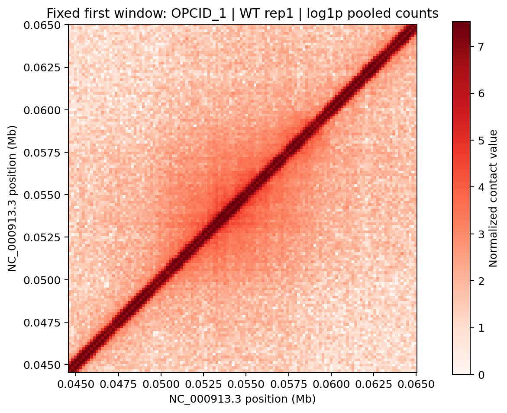

### 4.2 任务一：三分类模型及训练

默认空间划分人数如下；比例按染色体长度而不是样本数量计算。

| 子集 | CHID | CHIN | OPCID | 总数 |
| --- | ---: | ---: | ---: | ---: |
| 训练 | 18 | 178 | 52 | 248 |
| 验证 | 4 | 42 | 9 | 55 |
| 测试 | 4 | 30 | 7 | 41 |

模型依次为：2→16通道5×5卷积、BN、ReLU、2倍最大池化；16→32通道3×3卷积、BN、ReLU、2倍最大池化；32→64通道3×3卷积、BN、ReLU、全局自适应平均池化；64→3线性输出。两份生物学重复组成两个输入通道，不作为两条独立训练样本。

AdamW学习率0.001、weight decay 0.0001、batch size 32，最多40 epoch，验证Macro F1连续8轮不提升即早停，保留验证最佳权重，运行设备CPU。对照包括训练频数加权交叉熵、有放回均衡采样加普通交叉熵，以及类别加权Focal Loss（gamma=2）。匹配对照均使用种子2026/2027/2028；另有五种子加权基线稳定性实验。

### 4.3 标注冲突与区域级多标签

对不同类别标注计算正长度区间重叠，发现111对冲突、涉及145/344条标注。按重叠组件合并得到233个区域，划分为173/33/27，其中34个区域具有多个标签。相同CNN输出三个独立logit，使用训练正样本权重的BCEWithLogitsLoss。各标签阈值在验证集0.05–0.95网格上按F1选择，固定后原样用于测试。区域合并是监督规则，不意味着多个标签共存产生新的生物学机制。

### 4.4 归因与受控遮挡

归因覆盖全部41个测试结构、三个既有Focal模型，目标统一为真实类别logit，包括错判样本；在标准化输入上计算绝对输入×梯度，对两个通道平均并对称化。随机参数对照使用同架构、重置包括BN状态、固定种子9101/9102/9103。比较上三角距离≥800 bp区域的Spearman与前10%归因集合Jaccard，不只展示正确样本。

遮挡协议在运行前提交冻结。对5%/10%/20%高归因位置，将两个通道及对称像素同时替换为本样本、本通道、同距离偏移的中位数，保护距主对角线<800 bp位置。设置各20次距离匹配、距离×替换能量五分位匹配随机对照，以及同距最高输入能量位置对照。主指标为真实类别logit绝对变化，另保留有符号logit/概率降低；先在同一结构内合并种子，再跨41结构汇总，不把随机抽样视为独立生物学重复。

### 4.5 任务二：扫描、聚类与候选定义

唯一主版本为 `task2-main-v1`。六步流程如下：

1. 两份WT矩阵按16倍求和池化为160 bp，以20,480 bp窗口、2,560 bp步长扫描完整对角线窗口。
2. 质控要求有限像素比例≥99%、非零像素≥1%，两重复的零接触bin比例和最长连续零bin比例均≤3%。这避免将覆盖缺口形成的黑色十字当结构。
3. 提取8项特征：log总计数、非零比例、log近/远距离比、距离衰减斜率、中心富集、变异系数、接触熵、双重复相关。用中位数/IQR稳健缩放；PCA累计解释≥90%，最多6维。
4. k=2–8分别进行10次K-means++初始化，固定seed 2026，以平均轮廓系数选k。新颖度为到最近已知标注重叠窗口的PCA空间距离。
5. 候选窗口须与全部344条标注无直接重叠，且双重复上三角log1p Pearson r≥0.90。新颖度阈值取满足质控、无已知重叠和相关规则的候选池第90百分位，而不是全体窗口的前10%。
6. 命中窗口按起点间距≤5,120 bp合并，至少2窗口支持才输出区域，登记版本、染色体、起止坐标和代表窗口，禁止混用历史同名编号。

重复核验另外剔除偏移<5 bin的近对角线像素，再逐距离偏移减去平均log接触值后计算残差Pearson r；各偏移至少3对像素，常数向量不强行置为0或1。该检查固定候选，不根据审查结果再次筛选。

阈值敏感性使用r=0.88/0.90/0.92、新颖度分位0.85/0.90/0.95、最小支持2/3的18组合。未参与WT选择的突变条件用于补充纹理审查，非生物学实验确认。

### 4.6 已知结构覆盖与特征可分性诊断

从质控窗口选择起点为20,480 bp整数倍的187个不重叠窗口，其中141个任意重叠已知结构、46个无标注背景。按基因组中心划为五等分，测试人数32/40/39/38/38，训练窗口与测试窗口之间保留20,480 bp缓冲。每折只在训练区拟合稳健尺度，使用类别平衡L2逻辑回归（固定惩罚0.01、阈值0.5），分别测试密度2特征、其余6特征和全部8特征，不使用全局PCA。

100次折内标签打乱保留阳性数，作为描述性参照，不保留完整空间相关，不据此计算生物学p值。无标注不等于真实阴性。标注覆盖以窗口并集覆盖标注长度的比例计，不能把滑窗自然覆盖率称为识别器召回。

### 4.7 任务三：三条件四面板轨道

六份原始矩阵求和池化到160 bp，保留总计数。对每个bin统计环状染色体上bin中心距离≤10 kb的非对角线接触，并以全库上三角总计数（包括对角线）为分母乘10⁶得到CPM。一个非对角线接触会贡献到两个端点bin，故轨道CPM不是全基因组和等于百万的概率，也不是RNA表达。

先对同条件两个重复等权平均，再对三个条件均值等权平均，避免计数更多的样本获得更大权重；CSV同时保留重复样本标准差（ddof=1）。每图共享x轴：三条件曲线与灰色跨条件均值、灰色均值填充、蓝色RefSeq基因/名称、橙色WT CHIN/OPCID位置/名称。CHID未作为此课程指定轨道绘制。连续10 kb切片覆盖全染色体，末段按实际染色体长度截断。

### 4.8 任务五：公平超分辨率

输入为双通道160 bp、128×128矩阵，目标为同区域80 bp、256×256矩阵。按结构ID、标签、坐标及通道顺序配对，检查跨训练/验证/测试窗口正长度重叠。低分辨率沿用30,720 bp划分保护，高分辨率沿用20,480 bp保护（验证55），共同配对才得到训练248、验证54、测试41，CHIN_179排除，不事后统一历史划分。两分辨率都来自相同原始WT观测的空间聚合，不是独立低深度测序。

校正输入：`L_corrected=log1p(expm1(L_log)/4)`；输入/目标共享仅从训练目标拟合的逐通道尺度。网络在低分辨率上使用2→32的5×5卷积、32→32的3×3卷积、32→2的3×3卷积，前两层ReLU；将输入与学习残差分别双线性放大2倍后相加，再与转置平均保证对称。输出逆标准化后非负裁剪。双三次基线使用同一校正输入、输出尺度和非负裁剪。

AdamW学习率0.001、weight decay 0.0001、batch 16、最多20 epoch、patience 5，以验证MSE选权重，运行2026/2027/2028三种子。固定首个测试窗口用于案例图，显示统一0至目标99.5%分位色标，显示截断不影响指标。并保存全部41×2目标、插值和CNN矩阵用于复核。

### 4.9 评价指标与统计口径

分类报告Accuracy、每类Precision/Recall/F1、Macro F1和Macro Recall。Macro F1是三个类别F1的等权平均，避免多数类主导。多标签另报告按标签等权的Macro F1、全标签汇总Micro F1、全部标签同时正确的精确匹配率及逐标签错误比例Hamming loss。

重建MSE在log1p计数空间计算；逐图动态范围 $L=Y_{max}-Y_{min}$，PSNR为 $20\log_{10}(L/\sqrt{MSE})$。局部SSIM采用7×7均匀有效窗口、总体矩、K1=0.01/K2=0.03，逐图计算；其数值不与不同窗口/动态范围的SSIM直接横比。分层MSE只用上三角，排除距离<160 bp、保留160 bp；五个展示距离段从800 bp开始，另统计两个像素都位于已知标注区间内的像素对。这是明确原实现口径，未改变数值。

除注明折间波动、四分位数或配对中位差之外，“均值±标准差”指固定划分的种子间样本标准差（ddof=1），不是置信区间。分层重建先在每个种子内平均两重复矩阵再算结构MSE，再平均种子MSE，最后跨结构汇总；不等于先算两重复MSE再平均。所有空间相关、共享来源及小样本限制均保留。

## 5. 实验结果

### 5.1 三分类基线与类别不平衡策略

首轮加权CNN（seed 2026）Accuracy 0.5610、Macro F1 0.4587、Macro Recall 0.5103。始终预测CHIN的多数类基线Accuracy达0.7317，但Macro F1仅0.2817、Macro Recall 0.3333，说明Accuracy高不代表三类都能识别。

首轮CNN混淆矩阵如下，行是真实标签、列为预测标签。此表与图2对应**首轮加权模型**，不是三种子Focal平均混淆矩阵。

| 真实\预测 | CHID | CHIN | OPCID |
| --- | ---: | ---: | ---: |
| CHID | 1 | 3 | 0 |
| CHIN | 7 | 17 | 6 |
| OPCID | 0 | 2 | 5 |

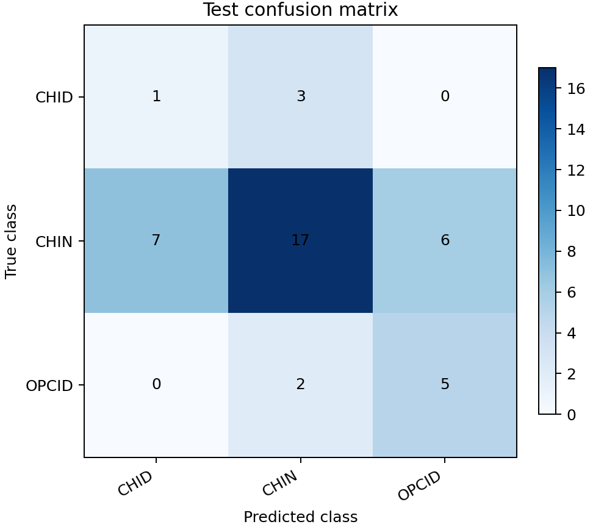

五种子加权基线Accuracy为0.6146±0.0401、Macro F1为0.4851±0.0566，CHID Recall为0.2500±0.1768。种子改变使CHID召回在0–0.5间波动；测试CHID仅4个，单例即改变0.25召回。

匹配三种子对照如下，主文采用整组均值而非最好一次：

| 策略 | Accuracy | Macro F1 | Macro Recall | CHID Recall |
| --- | ---: | ---: | ---: | ---: |
| 加权交叉熵 | 0.5935±0.0373 | 0.4795±0.0291 | 0.5373±0.0375 | 0.2500±0.0000 |
| 均衡采样 | 0.6423±0.0282 | 0.4792±0.0563 | 0.5354±0.0544 | 0.1667±0.1443 |
| Focal Loss | 0.6341±0.0244 | 0.4999±0.0168 | 0.5437±0.0324 | 0.2500±0.0000 |

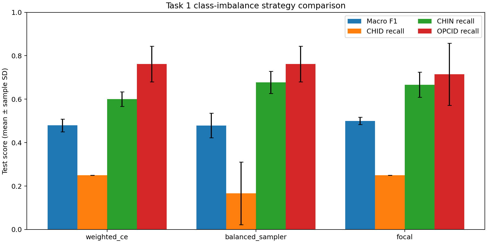

Focal在该组中Macro F1略高，但不能称统计显著优于其他策略。均衡采样提高Accuracy却未提高Macro F1。三种方法均未解决CHID薄弱问题。[完整基线记录](task1-baseline-results.md)

### 5.2 分辨率与窗口敏感性

固定20,480 bp、248/55/41划分及Focal，仅改变池化尺度：

| 等效分辨率 | 输入尺寸 | Accuracy | Macro F1 | Macro Recall |
| --- | --- | ---: | ---: | ---: |
| 80 bp | 256×256 | 0.5935±0.1387 | 0.4395±0.0410 | 0.5011±0.0577 |
| 160 bp | 128×128 | 0.6341±0.0244 | 0.4999±0.0168 | 0.5437±0.0324 |
| 320 bp | 64×64 | 0.5041±0.1228 | 0.4381±0.0465 | 0.5201±0.0179 |

固定160 bp，并用最大30,720 bp窗口规则统一边界排除，三组人数均为248/54/41：

| 窗口 | Accuracy | Macro F1 | Macro Recall |
| --- | ---: | ---: | ---: |
| 10,240 bp | 0.6829±0.0645 | 0.5163±0.0336 | 0.5540±0.0723 |
| 20,480 bp | 0.5935±0.0508 | 0.4895±0.0051 | 0.5614±0.0508 |
| 30,720 bp | 0.3821±0.0857 | 0.3465±0.0545 | 0.5016±0.0394 |

窗口对照排除验证CHIN_179，故20,480 bp结果不同于上一表，不能误写为重复运行不一致。10,240 bp截断8条CHID、3条CHIN、6条OPCID；30,720 bp的OPCID召回更高，但CHIN与总体下降。默认20,480 bp/160 bp兼顾标注覆盖与成本，而不是所有指标最优。各配置已看过同一测试区域，属于开发探索，不再把其选择声称为全新未见测试。[详细对照](task1-baseline-results.md)

### 5.3 冲突审计与多标签补充

验证、测试CHID标注均涉及跨类别重叠，说明模型错误不宜全部解释为网络表达能力不足。多标签实验结果：

| 指标 | 三种子结果 |
| --- | ---: |
| Macro F1 | 0.6439±0.0546 |
| Micro F1 | 0.8037±0.0118 |
| 精确匹配率 | 0.5309±0.0214 |
| Hamming loss | 0.1687±0.0071 |

| 标签 | 测试阳性数 | F1 | Recall |
| --- | ---: | ---: | ---: |
| CHID | 4 | 0.4667±0.1764 | 0.3333±0.1443 |
| CHIN | 23 | 0.9189±0.0019 | 0.9855±0.0251 |
| OPCID | 7 | 0.5460±0.0220 | 0.5714±0.0000 |

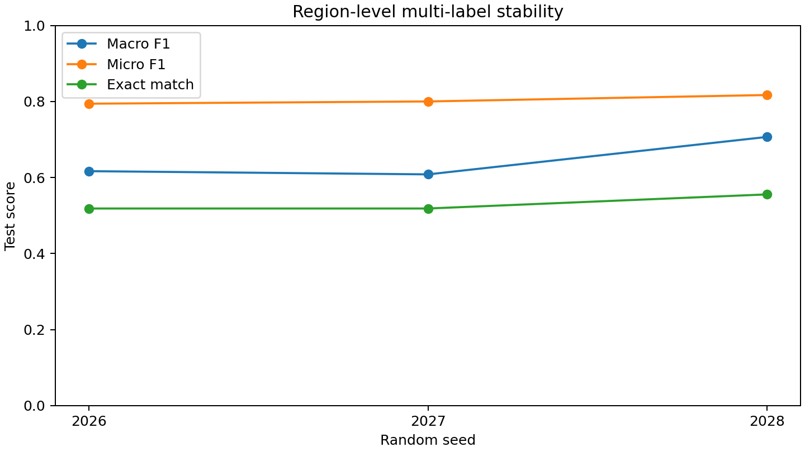

只预测训练多数标签CHIN的基线Macro F1/Micro F1/精确匹配率分别为0.3067/0.7541/0.5926。CNN提高前两者但精确匹配率更低，体现少数标签识别与额外错误的取舍。CHIN平均验证阈值0.05触及网格下界，仍需警惕多数类先验。该结果不证明三分类Accuracy改善，亦不意味着CHID问题已解决。[多标签结果](task1-multilabel-results.md)

### 5.4 可解释性核验

| 全41结构汇总指标 | 训练模型间 | 训练—随机参数对照 |
| --- | ---: | ---: |
| 去近对角线Spearman中位数 | 0.6395 | 0.5832 |
| 前10%集合Jaccard中位数 | 0.2645 | 0.2023 |

训练网络近对角线归因质量比例15.21%，随机网络32.73%；标注面积归一化富集分别1.54和3.12。随机网络也出现较强相似性与富集，**漂亮热区或与标注重合不能单独证明学到结构机制**。图5固定展示CHID_23、CHIN_221、OPCID_62，前者三个模型均错判为CHIN，保留失败案例。[归因审计](task1-saliency-audit.md)

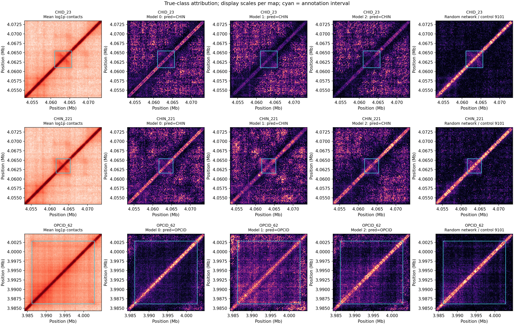

遮挡共生成15,498条扰动记录、1,107条模型配对、369条结构配对及36组汇总，0张不可评估图。下表为高归因遮挡相对对照的目标logit绝对变化配对中位差；括号为正差结构数/41。

| 遮挡比例 | 距离匹配随机 | 距离×能量匹配随机 | 同距输入能量对照 |
| --- | ---: | ---: | ---: |
| 5% | 0.1723（40/41） | 0.1440（38/41） | 0.0906（37/41） |
| 10% | 0.2787（40/41） | 0.2188（37/41） | 0.1148（35/41） |
| 20% | 0.3941（40/41） | 0.3047（37/41） | 0.1041（34/41） |

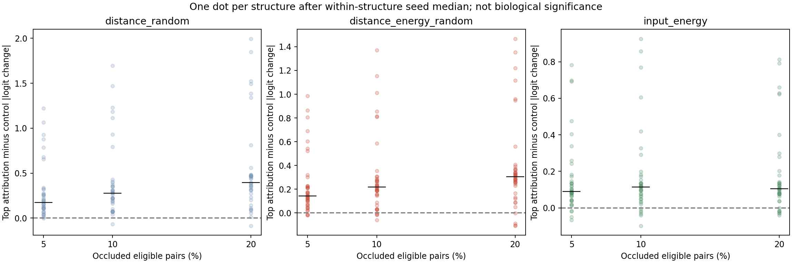

高归因位置通常比匹配位置更影响模型，但有符号变化因类别而异：5/10/20%遮挡的CHID目标logit降低中位数为0.9267/1.3474/1.9305，CHIN为−0.1305/−0.2302/−0.3760，OPCID为−0.7932/−0.9916/−1.1543。负数意味着遮挡后目标分数反而升高。绝对归因只能说明敏感，不能说明正向证据；能量分层也不是精确能量相等，替换可能分布外，空间纹理未完全匹配。[遮挡审计](task1-occlusion-audit.md)

### 5.5 全基因组候选、簇与稳定性

1,807窗口中1,498通过、309未通过质控。PCA保留3维解释94.58%方差；k=2–8轮廓系数依次为0.4073、0.3865、0.3305、0.3257、0.3067、0.3085、0.2947，因此主流程选择2簇。

| 簇 | 成员数 | 已知重叠数 | 无已知重叠数 | 已知重叠比例 |
| --- | ---: | ---: | ---: | ---: |
| 0 | 603 | 450 | 153 | 74.63% |
| 1 | 895 | 669 | 226 | 74.75% |

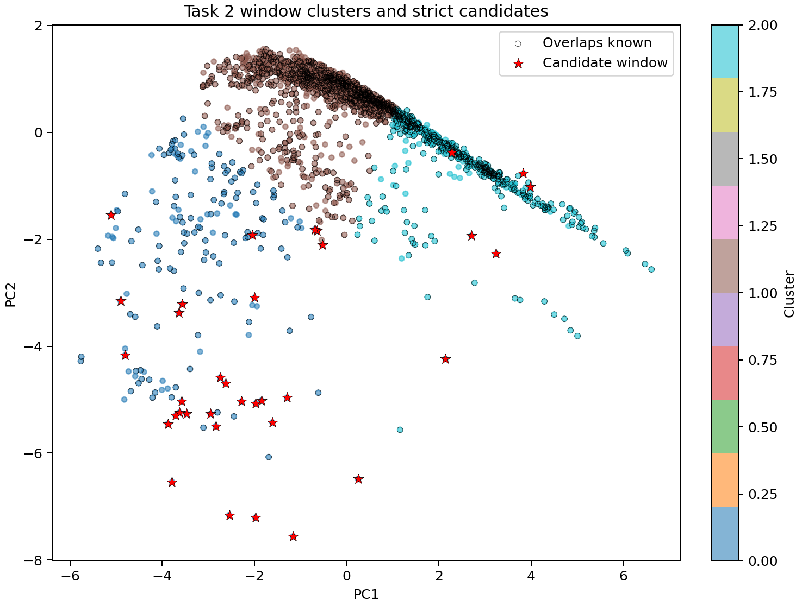

两簇均含约75%已知窗口，不是两个纯新结构簇。成员、冻结中心、最近中心真实窗口与支持关系已导出，中心核对最大差1.73×10⁻¹⁷；最近中心图是实际窗口，不是PCA中心可直接反变换得到的平均接触图。[簇证据](task2-cluster-evidence.md)

379个无已知直接重叠合格窗口中，筛出25个命中窗口，其中14个支持5区域、11个未满足合并支持规则。下表坐标均为NC_000913.3的0-based左闭右开区间；“簇”仅是代表窗口标签。

| 候选 | 合并区间（bp） | 支持数 | 代表中心 | 代表簇 | 新颖度 | 原始log相关 | 最近已知距离 | 18设置复现比例 |
| --- | --- | ---: | ---: | ---: | ---: | ---: | ---: | ---: |
| 001 | 1,251,840–1,280,000 | 4 | 1,262,080 | 0 | 0.6546 | 0.9357 | 400 bp | 66.7% |
| 002 | 1,891,840–1,914,880 | 2 | 1,904,640 | 0 | 0.8167 | 0.9429 | 20,440 bp | 61.1% |
| 003 | 1,978,880–2,004,480 | 2 | 1,989,120 | 0 | 0.7317 | 0.9302 | 11,570 bp | 50.0% |
| 004 | 3,458,560–3,486,720 | 4 | 3,473,920 | 1 | 1.3338 | 0.9330 | 14,980 bp | 94.4% |
| 005 | 4,172,800–4,195,840 | 2 | 4,183,040 | 0 | 2.1925 | 0.9696 | 21,560 bp | 50.0% |

稳定身份如 `task2-main-v1:NC_000913.3:3458560-3486720`，以[登记表](task2-candidate-registry.csv)为准。候选004支持窗口跨簇：3个属簇1、1个属簇0，不能将整个区域定为一种簇类别。其余候选支持均为簇0。18设置候选数0–10、中位4，显示数量对阈值敏感；004较稳定，005虽新颖度和相关最高但只有50%设置复现，001需警惕距已知400 bp的边界效应。

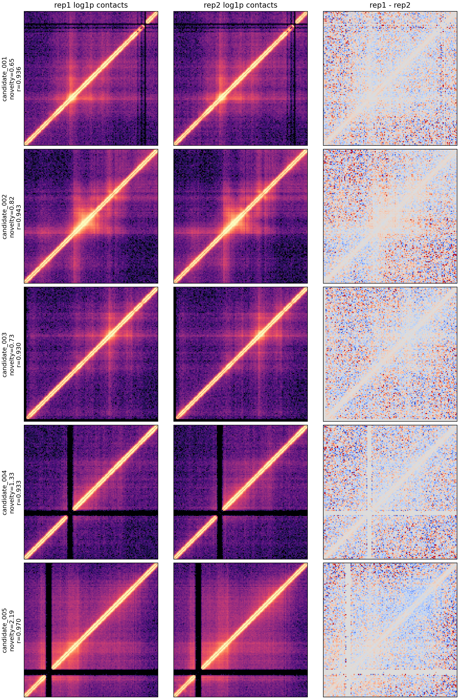

热图呈现的是代表窗口，合并区间可能比20,480 bp更长，二者不能混为同一矩阵范围。相邻滑窗共享87.5%位置，4窗口支持不是4个独立生物学重复。[候选主结果](task2-clustering-results.md)

### 5.6 去距离趋势、独立条件和尺度审查

五代表窗口重复相关在去近对角线与距离中心化后均下降：

| 候选 | 原始log相关 | 距离≥800 bp相关 | 距离中心化残差相关 |
| --- | ---: | ---: | ---: |
| 001 | 0.9357 | 0.8558 | 0.7787 |
| 002 | 0.9429 | 0.8832 | 0.7092 |
| 003 | 0.9302 | 0.8306 | 0.7447 |
| 004 | 0.9330 | 0.8268 | 0.7654 |
| 005 | 0.9696 | 0.9448 | 0.9311 |

残差相关支持可重复纹理，但0.90原阈值不能直接套用于新残差指标。代表窗口与整个合并区间长度不同，其审查结果也不能直接混用。[重复审计](task2-replication-audit.md)

固定整个合并区间，WT与突变体四种重复配对先取候选内中位，再在五候选间汇总。80/160/320 bp下WT→ΔstpA中位残差相关为0.305/0.473/0.690，WT→ΔhnsΔstpA为0.260/0.467/0.757。320 bp实际排除3 bin即960 bp，另外两尺度恰为800 bp。变粗会平滑并提高相关，不能把粗尺度高相关当更多重复证据。[尺度审查](task2-resolution-audit.md)、[跨条件审查](task2-condition-transfer-audit.md)

在未参与筛选的突变条件中，比较5个固定代表窗口与329个避开候选及已知区间的背景窗口：

| 设置 | 候选残差相关中位数（Q1–Q3） | 背景中位数（Q1–Q3） |
| --- | ---: | ---: |
| 原计数，ΔstpA | 0.515（0.462–0.795） | 0.309（0.201–0.453） |
| 原计数，ΔhnsΔstpA | 0.612（0.580–0.730） | 0.292（0.179–0.396） |
| CPM，ΔstpA | 0.787（0.655–0.919） | 0.540（0.357–0.718） |
| CPM，ΔhnsΔstpA | 0.849（0.715–0.894） | 0.517（0.308–0.690） |

四设置候选中位数均高于背景，支持部分候选在独立条件中有较可重复纹理。但候选仅5个、背景互相重叠且无标注不是确定阴性，不报告显著性或突变因果。CPM之后还经过非线性log1p，改变相关数值是可能的，不用Pearson在线性缩放下不变性错误否定此敏感性结果。[背景对照](task2-mutant-background-control.md)

### 5.6.1 候选隔离后的单重复冻结簇迁移

10月13日协议`215a307`先提交，再从200个不重叠网格加3个代表共203窗中，仅用远离5候选及两侧20,480 bp保护带的182个WT rep1窗口拟合。固定7个单重复特征、训练中位数/IQR、3维PCA与k=2中心，其他来源不重拟合；不使用双重复平均或相关性。此为新的诊断分区，不替代原8特征主簇，WT2曾参与候选选择，不是独立新结构验证集。

| 重复对 | 共同QC窗口 | 同标签一致率 | 参考簇平衡一致率 | ARI | 全非零循环位移ARI 95%范围 |
| --- | ---: | ---: | ---: | ---: | ---: |
| WT | 200 | 0.9750 | 0.9754 | 0.9020 | −0.0049–0.0240 |
| ΔstpA | 198 | 0.9697 | 0.9451 | 0.8245 | −0.0968–0.1155 |
| ΔhnsΔstpA | 198 | 0.7071 | 0.8232 | 0.1673 | −0.0050–0.0246 |

WT与单突变归属较一致，双突变明显较弱。全部5候选没有重选：001/003双突变不一致；002各条件内部一致但单突变簇号不同于WT；004单突变在边界两侧（裕度0.0101/0.0013），005双突变rep1未通过QC，相同标签不能抵消QC失败。裕度不是概率，循环位移范围不是p值，特征仍含强度/衰减，不能推断形态或机制。该结果完善诊断和反证，未解决下节原AUC失败或确认新结构。[完整协议、候选表与结果](task2-cluster-transfer.md)

### 5.6.2 看到弱迁移后的冻结库总量敏感性

追加协议`c603360`提交后，仅增加一个CPM对照：六来源分别用自身完整上三角总计数归一后计算同7特征。仍仅WT1原182窗口拟合新诊断分区，所有评估窗口、训练ID、QC、保护带/k/PC/种子不变。由看到原始弱结果触发，因此是事后敏感性分析，不是盲测；不继续扫描其他参数，不把两套簇编号视为同一种形态。

| 重复对 | 原始一致率 / ARI | CPM一致率 / ARI |
| --- | ---: | ---: |
| WT | 0.9750 / 0.9020 | 0.9800 / 0.9207 |
| ΔstpA | 0.9697 / 0.8245 | 0.9394 / 0.7456 |
| ΔhnsΔstpA | 0.7071 / 0.1673 | 0.7980 / 0.3524 |

双突变改善但仍40/198归属不一致；单突变略降。候选001从双突变不一致变一致，004由单突变不一致变为双突变不一致，003双突变问题和005 QC失败保留。CPM不是局部覆盖/距离校正，也不能把所有差异因果归为测序深度；只支持处理敏感性，不解决新类别认证。完整结果同时保留，不用较好的处理替换较差结果。新版普通wheel安装环境210项工程测试通过。[全表、库总量、命令与边界](task2-cluster-depth-sensitivity.md)

### 5.7 关键失败对照：覆盖不等于可分性


| 特征组 | 五折AUC均值±折间SD | 汇总留出召回 | 特异度 | 平衡准确率 |
| --- | ---: | ---: | ---: | ---: |
| 密度2项 | 0.4083±0.1045 | 0.4397 | 0.5000 | 0.4699 |
| 形态/重复6项 | 0.4971±0.1089 | 0.6170 | 0.3913 | 0.5042 |
| 全8项 | 0.5582±0.0964 | 0.5957 | 0.4783 | 0.5370 |

100次打乱标签的平均AUC经验范围为0.3677–0.6064（2.5%–97.5%），观察0.5582位于范围内，尚无稳定可分性支持。全部预测阳性的召回为1、特异度0、平衡准确率0.5；故只报召回会产生误导。新增36/72项形态及跨重复探索AUC约0.53–0.56，也未解决该缺口。

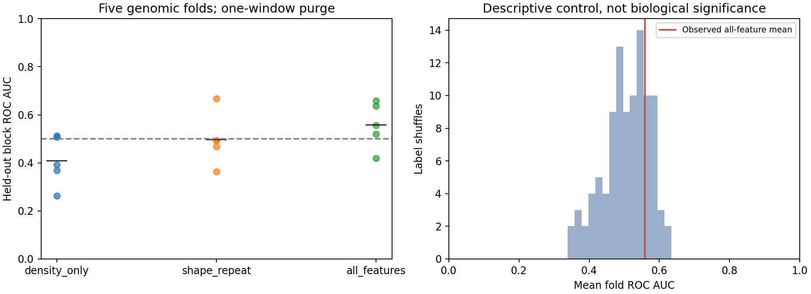

| 阶段：至少覆盖标注长度50% | CHIN（250） | OPCID（68） | CHID（26） |
| --- | ---: | ---: | ---: |
| 全滑窗并集 | 100% | 100% | 100% |
| 质控通过窗口并集 | 94.4% | 100% | 96.15% |
| 不重叠核验网格 | 75.6% | 95.59% | 61.54% |
| 全特征留出预测阳性窗口并集 | 51.2% | 57.35% | 57.69% |

第一行只是扫描覆盖，最后一行是诊断分类器对象覆盖；均不等同于有意排除已知的新颖候选筛选召回。[覆盖与诊断](task2-feature-benchmark.md)

进一步固定背景、空间折与缓冲，只改变已知标签覆盖定义：

| 已知窗口定义 | 正例 | 背景 | 排除模糊窗口 | AUC |
| --- | ---: | ---: | ---: | ---: |
| 任意正长度重叠 | 141 | 46 | 0 | 0.5582±0.0964 |
| 已知并集覆盖≥25%窗口 | 51 | 46 | 90 | 0.7023±0.0542 |
| 已知并集覆盖≥50%窗口 | 13 | 46 | 128 | 0.8842±0.0493 |
| 已知并集覆盖≥75%窗口 | 1 | 46 | 140 | 缺类，不报告 |
| 中心位于已知区间 | 40 | 46 | 101 | 0.6648±0.0625 |

较高覆盖子集更容易区分，但删去了大量模糊正例、改变了难度。≥50%仅13正例，其中一折只有1正例，不能拿0.8842替代原0.5582，亦不能反推原标注“错误”。此表的分母为窗口长度，与前表逐标注覆盖分母不同。[标签敏感性](task2-label-sensitivity.md)

### 5.8 三条件全基因组可视化

六重复生成29,011个160 bp bin轨道，465个连续10 kb区间完整覆盖染色体，末段4,640,000–4,641,652 bp。图10取固定50,000–60,000 bp区间，便于对照图1的OPCID_1附近坐标，不以最大条件差异选图。

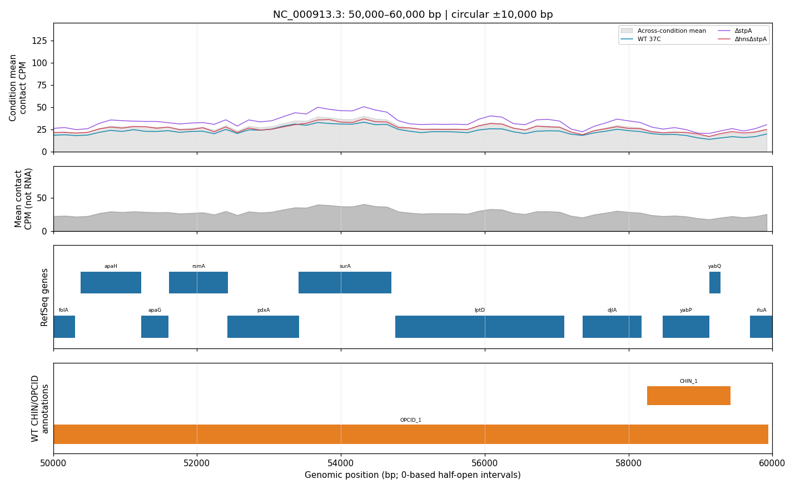

上方面板中紫色ΔstpA曲线在该区域多数位置高于WT与双突变，约54 kb附近三曲线均有局部升高；灰色曲线/填充是跨条件等权均值。第三面板显示apaH、rsmA、surA、lptD等基因位置，第四面板显示跨越该区间的OPCID_1及局部CHIN_1。被窗口边界截断的带不表示结构真实终止。

这些共定位和曲线强弱只是可视化观察，不能推出转录表达、差异显著、结构消失或突变机制。原自检验证六不同源文件、方法/清单、坐标、均值、非负有限数值和全部PNG完整性/尺寸；本日随后在新环境从原始输入重建并重绘全部465图，解码RGBA像素完全一致。预定首段、50–60 kb、末段已目视复核，不声称所有图层逐张人工语义验收。末bin仅52 bp，接触CPM未按宽度变为每bp密度，尾端低值可能受短bin影响。[任务三证据](task3-visualization-results.md)、[隔离重绘](task3-reproduction.md)

### 5.9 公平超分辨率及结构分层结果

| 方法 | PSNR（dB） | 局部SSIM | MSE（log1p空间） |
| --- | ---: | ---: | ---: |
| 校正双三次 | 23.3292±0 | 0.48828±0 | 0.208434±0 |
| 对称残差CNN | 23.6629±0.0018 | 0.51285±0.00080 | 0.193011±0.000079 |

CNN提高PSNR约0.334 dB、SSIM 0.02458，MSE降低约7.40%。三种子最佳epoch为20/20/18，双三次不受种子影响故SD为0。旧版未校正基线“14.685→23.638 dB”结论撤回，不作为本实验增益。

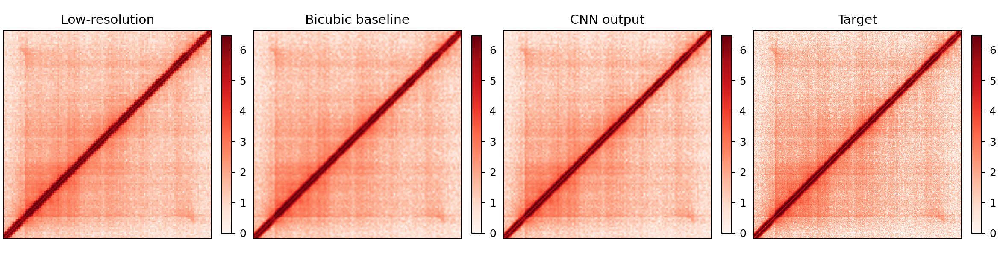

| 分层 | 结构数 | 双三次MSE | CNN MSE | 相对变化 |
| --- | ---: | ---: | ---: | ---: |
| 0.8–1.6 kb | 41 | 0.0912 | 0.0844 | −7.4% |
| 1.6–3.2 kb | 41 | 0.1110 | 0.1009 | −9.1% |
| 3.2–6.4 kb | 41 | 0.1206 | 0.1088 | −9.8% |
| 6.4–10.24 kb | 41 | 0.1219 | 0.1097 | −10.0% |
| 10.24–20.48 kb | 41 | 0.1150 | 0.1036 | −9.9% |
| CHID区间内 | 4 | 0.0851 | 0.0744 | −12.6% |
| CHIN区间内 | 30 | 0.0674 | 0.0529 | −21.5% |
| OPCID区间内 | 7 | 0.0774 | 0.0691 | −10.7% |

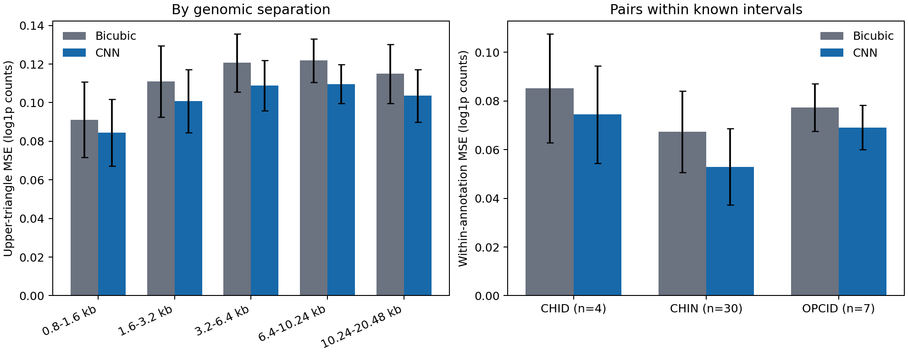

各分层平均MSE均下降，但CHID只有4例；两重复/三种子不是额外独立结构样本。完整测试重建矩阵每方法形状 `(41,2,256,256)`，每种子压缩产物约38.4 MB，保存在忽略的输出目录。结果支持内部像素重建小幅改善，不证明恢复新增真实接触、实验分辨率或三维构象。[任务五完整协议](task5-super-resolution-results.md)

### 5.9.1 配对空间组不确定性与距离残差保真

10月13日不重训，核对三个种子元数据/目标/双三次一致并重算492行PSNR/SSIM/MSE，在1e-12内匹配旧指标。每结构平均两通道和三个种子的指标，仅形成41个结构，不把通道/种子当独立样本；这不同于上一节先平均两通道矩阵再算分层MSE。

补充距离中心化Pearson r：在已经log1p的图上保留≥800 bp、排除仅1–2像素的外围偏移，各方法分别减去对应偏移均值后相关，不做第二次log。双三次/CNN残差r均值为0.669821/0.678883，增益0.009062；结构内平均后PSNR/SSIM/MSE/r均为41/41改善，不表示每个通道或像素都改善。

| 预设空间抽样单位 | 组数 | PSNR增益95%百分位区间 | 残差r增益95%区间 |
| --- | ---: | ---: | ---: |
| 正长度重叠连通分量 | 13 | 0.321101–0.340949 | 0.007503–0.010690 |
| 每窗两侧扩大20,480 bp后分量 | **仅2** | 0.325269–0.335429 | 0.008988–0.009417 |
| 窗口跨界传递合并100 kb网格 | 5 | 0.322232–0.339759 | 0.006849–0.009947 |

组bootstrap固定10,000次、seed=2026，整组放回、方法保持配对，统计结构加权均值，不依结果选最有利分组。**2组区间只有有限抽样组合，窄区间不能解释成高精度**；三方案均仅描述固定测试区，不能当独立生物学或跨条件置信区间。未放宽训练history容差，原严格`diverged`仍保留。[逐结构小表、删组范围与全部指标](task5-paired-uncertainty.md)

## 6. 实现、证据追溯与复现核验

### 6.1 环境与模块

实测环境为macOS arm64、CPython 3.9.6、CPU训练/推理；主要包包括Cooler 0.10.4、h5py 3.14.0、NumPy 2.0.2、Pandas 2.3.3、Matplotlib 3.9.4、openpyxl 3.1.5及PyTorch 2.8.0。精确运行/测试版本见[环境快照](../requirements-lock-macos-py39.txt)，构建版本见[构建快照](../requirements-build-lock.txt)。快照不是含哈希的跨平台锁文件，其他平台需重新验证。

| 目录 | 职责 |
| --- | --- |
| `src/microc_foundation/` | 读取、坐标、归一化、数据集、分类、聚类、轨道与重建业务逻辑 |
| `scripts/` | 分步骤运行入口、审计与提交检查 |
| `tests/` | 边界、错误输入、数学及小型数据夹具测试 |
| `data/raw/`、`data/processed/` | 本地真实源数据与中间张量，Git忽略 |
| `outputs/` | 权重、逐样本结果、完整矩阵与运行凭据，Git忽略 |
| `docs/` | 中文开发日志、审计协议、结果快照、报告与可移植配图 |

每轮按阶段提交，并记录实现、实际运行、失败与尚缺。公开仓库不含大体积真实矩阵与权重，不能把GitHub克隆即声称为无需数据的完整实验。最终代码ZIP需另附允许分发的必要权重、结果及数据获取说明。

### 6.2 数据身份

| 文件 | SHA-256 |
| --- | --- |
| 标注工作簿 | `a1fa9c0d359509a9eb319442c19e300cb5da85546eeb567368a390d22205167a` |
| WT rep1 | `0256e10da36abfe0238bf16952bc43bc78365f43c201e6e3ba0c49bd243549a8` |
| WT rep2 | `ede9b4f7c0c6b40c8f098e43cdd0abbc0a8987f05e8b37051a5e3cbf143ad106` |
| 默认完整窗口NPZ | `8708039a77fa210c7aaf06459e9cb69ea934ad5d3b6ccf76b8fd44da935d461d` |

原始计数、路径、方法和模型身份分别保存在运行receipt/provenance/指标中。输出压缩封装字节可能随实现变化，一般复现应比较数组及元数据；哈希用于标识本轮具体输入，不代替方法正确性。

### 6.3 已完成的隔离核验

旧开发环境的editable安装指向旧目录，曾依赖 `PYTHONPATH=src`运行。为排除这类“只能在开发目录运行”的风险，从已提交 `bc384fa` 构建普通wheel，创建不继承系统包的新环境，以 `python -I`、无PYTHONPATH运行核验。新包从该环境site-packages导入，拒绝editable及环境外业务包。

从真实Excel和两份原始10 bp WT矩阵重建标注、空间划分及全部344双重复窗口，用时约59.9秒，全部15字段精确一致、矩阵最大差0，固定首窗热图核验通过。同一隔离包再读取三份已有Focal权重，重新估计训练尺度并预测41测试结构：

| 原训练种子 | 逐结构预测一致 | Accuracy | Macro F1 |
| --- | ---: | ---: | ---: |
| 2026 | 41/41 | 0.658537 | 0.518519 |
| 2027 | 41/41 | 0.609756 | 0.495319 |
| 2028 | 41/41 | 0.634146 | 0.485810 |

123条三模型预测及分类统计一致，不是123个独立新测试样本。历史权重缺seed字段，首跑失败后只读核对指标及目录，核验器记录种子来源而不补写旧权重；旧logit未保存，不能声称logit逐数值重现，本次也未重算旧Focal损失。原始失败记录保留。

底座及推理核验阶段隔离环境全仓155项自动测试通过，0失败/错误/跳过，Ruff与差异空白检查通过；随后161/169/179项，补任务五与只读诊断后最新194项。这些测试主要证明接口、数学与工程约束，不是生物学验证；代码测试通过也不将任务五真实重训的严格diverged状态变为通过。底座与推理本身不包含重新训练，其他独立核验见以下各节。[底座核验](foundation-reproduction.md)、[权重推理核验](task1-inference-reproduction.md)

### 6.4 任务二主候选计算链隔离复现

先将验收协议提交为`ebbbfef`，再在同一隔离环境普通wheel上重新解析原始Excel，从两份10 bp WT原始矩阵重新求和池化，完成全部扫描、PCA、k=2–8聚类比较、新颖度及候选合并。输出使用新的空目录，不复用160 bp缓存、不覆盖旧凭据、不重设阈值。用时168.28秒，所有阶段通过。

新旧两份池化矩阵各29,011个bin及141,955,644/137,745,984个上三角pixel逐项精确一致，原计数总量守恒。1,807×72扫描表、1,498×83成员表、25×83初选表和5×12区域表的身份/坐标/质控/簇/支持关系与顺序精确一致，所有浮点最大绝对差均为0；PCA、中心、各k轮廓系数及阈值摘要也一致。容差在运行前固定为相对/绝对1e-12，没有事后重排簇号或PCA符号。

两份COOL容器哈希因创建信息及封装改变而不同，验收依据是全部bin/pixel内容，而非HDF5文件字节。扫描摘要仅规范化两份新输出路径；其余参数与统计逐项比较。输入/参考/脚本/输出哈希与环境保存在receipt，新生成PCA图已目视核验。运行器新增6项测试后，全仓161项通过。

这使“原始数据→主候选”的复现不再只是旧文件自检，但未重跑所有突变、尺度、形态及特征诊断支路；仍是同机同数据，原AUC 0.5582和新结构未确认的限制不变。[冻结协议与结果](task2-reproduction.md)、[精简凭据](task2-reproduction-summary.json)

### 6.5 任务三六原始文件到全轨道/图的隔离复现

先提交冻结协议`09bd308`，再从六份原始10 bp矩阵、Excel和GFF重算，不复用池化缓存、不改绘图参数。用时269.14秒，六份160 bp矩阵各29,011个bin及全部上三角pixel精确一致、计数总量守恒；29,011×11轨道表的坐标、条件均值、双重复标准差、跨条件均值逐项一致，浮点最大差0。来源与全465区间清单仅规范化源文件目录，方法/身份/顺序/图层计数及数值均一致。

全部465张1430×880图重新绘制并完整解码，RGBA像素与旧图精确相同，最大通道差0。预定0–10 kb、50–60 kb及末段4,640,000–4,641,652 bp已目视复核，首尾无已知CHIN/OPCID条带与清单一致。完整输入/参考/脚本/输出哈希及环境存receipt；当轮169项测试通过。像素一致不保证所有注释生物学语义正确，也不保证跨平台字体像素相同。[复现协议及三案例](task3-reproduction.md)、[精简凭据](task3-reproduction-summary.json)

末bin为4,641,600–4,641,652，仅52 bp。当前轨道按每bin接触计数进行CPM，并未做每bp密度归一化，故尾端低值可能受bin宽度影响；这是一项展示边界限制，不事后改变方法以抹平图像。

### 6.6 默认三种子Focal模型从原始数据重新训练

先提交协议`075a7a8`，再在隔离普通wheel上从原始Excel/两10 bp WT重新提取全部344窗口，15字段精确相同；从随机初始化训练2026/2027/2028三个Focal主模型，未读取旧权重初始化、未改策略/参数。设置为CPU单线程、batch32、AdamW学习率0.001/权重衰减0.0001、gamma2、最多40轮、验证Macro F1选择与patience8早停。完整运行150.92秒，一次通过。

| 种子 | 最佳轮/实际轮 | 测试Accuracy | 测试Macro F1 | 与历史结果比较 |
| --- | --- | ---: | ---: | --- |
| 2026 | 23/31 | 0.658537 | 0.518519 | 全日志/指标/23张量一致 |
| 2027 | 16/24 | 0.609756 | 0.495319 | 全日志/指标/23张量一致 |
| 2028 | 30/38 | 0.634146 | 0.485810 | 全日志/指标/23张量一致 |

合计93轮×5列history、完整metrics（含验证/测试损失、身份/预测及全部分类统计）最大浮点差0，三模型69个参数/BN缓冲张量精确相同。元数据除原权重缺seed外逐项一致，旧种子从原指标/目录核对，新权重必须保存对应seed。权重封装字节因seed元数据而不同，不当作计算差异。固定首个种子2026新曲线与混淆矩阵已目视核验；原性能均值和CHID弱项没有变化。

历史输出未记录完整CLI和CPU线程数，优化参数依据方法文档及原入口默认值，本轮固定1线程且未调参追平。结果相同不能补回丢失的历史运行配置或认证跨平台确定性。该复现只覆盖默认三个Focal主模型，不覆盖其余策略/尺度/多标签/归因训练支路，也不是新独立测试；123条预测仍是41结构的三模型重复。全仓179项测试通过，0失败/错误/跳过，依赖与旧证据自检通过；自检不等于超分辨率重训。[冻结协议、真实曲线及命令](task1-training-reproduction.md)、[精简凭据](task1-training-reproduction-summary.json)

### 6.7 公平超分辨率重新训练与严格日志差异

协议`52d2db5`冻结后从原始Excel/两10 bp WT重建低/高窗口，两套各15字段/dtype/形状/身份/数值精确相同。共同配对248/54/41、排除CHIN_179不变；按原公平校正和模型/优化/评价设置、CPU单线程，从随机初始化重训2026/2027/2028三模型，各20轮，最佳轮20/20/18。用时416.71秒，仅执行一次，没有试参追平。

三模型共18参数张量和元数据精确相同；所有41×2×256×256目标/双三次/CNN及11个归档字段精确相同。492行逐样本指标最大差2.22e-16，完整metrics/种子汇总最大差1.11e-16，均在原容差内；4张分层CSV的410/82/10/6行精确相同。PSNR约0.334 dB的小幅改善及原生物学限制不变。

**总体严格状态为diverged。** 60轮×3列history的epoch相同，但训练/验证损失有微小差异，超过事前绝对/相对1e-12，未事后放宽：

| 种子 | 训练损失最大差 | 验证损失最大差 |
| --- | ---: | ---: |
| 2026 | 4.8068e-9 | 1.3245e-8 |
| 2027 | 4.3261e-9 | 6.6227e-9 |
| 2028 | 3.8455e-9 | 5.7949e-9 |

首跑还有分层summary内存np.str_/JSON str严格类型误报；修正`3fe80c8`只比较实际序列化JSON后，单独复核最大差0，真实标签变动仍由测试拒绝。原误报及diverged receipt保留，没有为此重训或改数据。

版本化只读诊断以相同最佳权重、全54验证结构和batch16，比较1线程与本机默认4线程。三模型验证预测张量精确相同，1线程损失对应新最佳轮日志，4线程对应旧日志，按原容差匹配。这支持浮点损失归约的解释，但没有逐轮重建旧模型或确认完整历史CLI，故不将原严格状态改成通过。两张新图已目视核验并与原文档图像素一致；代码全仓194项测试通过，与真实复现状态分别报告。[协议、命令与差异](task5-reproduction.md)、[精简凭据](task5-reproduction-summary.json)

### 6.8 增强核验图与边界

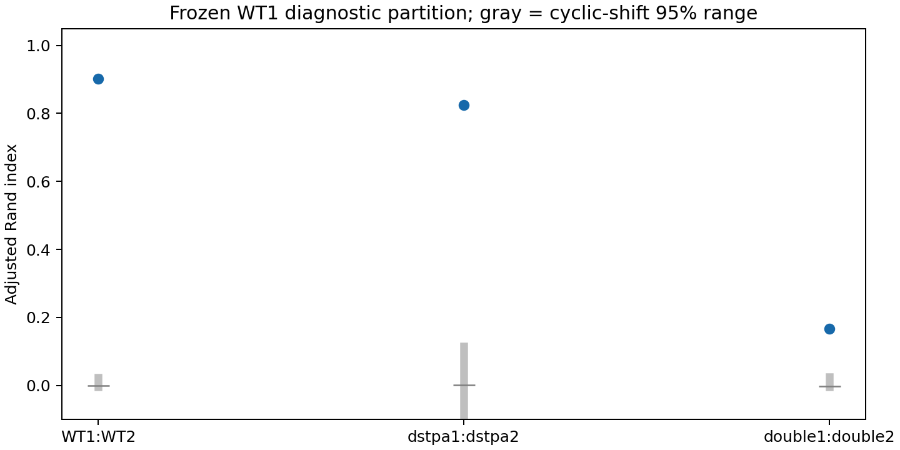

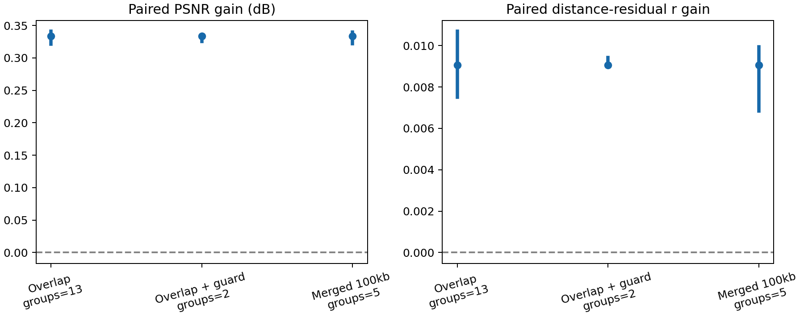

两图均来自上述真实核验，不是重新训练或挑参数；灰区/蓝区间的含义不同，分别为循环位移ARI分布和配对组bootstrap区间。追加CPM后最新210项工程测试通过，不等于任务二新结构确认或任务五严格history通过。

### 6.9 证据索引

| 报告结论 | 可核验依据 |
| --- | --- |
| 原数据、坐标和任务覆盖 | [数据质检](data-quality-report.md)、[坐标审计](annotation-coordinate-audit.md)、[要求核验](course-requirements-audit.md) |
| 分类、冲突、归因 | [三分类](task1-baseline-results.md)、[多标签](task1-multilabel-results.md)、[归因](task1-saliency-audit.md)、[遮挡](task1-occlusion-audit.md) |
| 唯一候选版本与簇 | [主结果](task2-clustering-results.md)、[稳定登记](task2-candidate-registry.csv)、[簇成员/中心](task2-cluster-evidence.md) |
| 候选失败对照与敏感性 | [区域留出](task2-feature-benchmark.md)、[标签敏感性](task2-label-sensitivity.md)、[独立背景](task2-mutant-background-control.md) |
| 三条件与重建 | [轨道](task3-visualization-results.md)、[校正重建](task5-super-resolution-results.md)、[重建JSON快照](task5-corrected-summary.json) |
| 开发与验收边界 | [中文日志](development-log.md)、[质量清单](quality-review.md) |
| 任务二原始输入到主候选复现 | [隔离复现](task2-reproduction.md)、[逐项比较凭据](task2-reproduction-summary.json) |
| 任务三六原始输入到全部轨道/图 | [隔离重绘](task3-reproduction.md)、[全图比较凭据](task3-reproduction-summary.json) |
| 默认三种子Focal重新训练 | [原始数据训练复现](task1-training-reproduction.md)、[逐项比较凭据](task1-training-reproduction-summary.json) |
| 公平超分辨率重训及严格差异 | [原始数据重训/只读诊断](task5-reproduction.md)、[保留diverged的凭据](task5-reproduction-summary.json) |

## 7. 讨论与局限

### 7.1 分类性能为何不能简单归为“完成识别”

模型在Macro F1上超过多数类规则，但Accuracy仍低于始终预测CHIN的0.7317。两者并不矛盾：模型承担了识别少数类的代价，而多数类规则完全忽略它们。CHID训练仅18、测试4，重叠监督与类别分布使模型不稳定；Focal和均衡采样未充分解决。多标签更贴近重叠标注，但改变了样本单位，且CHIN阈值低、CHID仍弱，不能用一个更高F1掩盖三分类不足。

### 7.2 任务二尚未达到确认新结构的标准

未与现有标注重叠，只表示“未被当前清单标注”，可能是已知结构的延伸、漏标、深度差异或技术伪影。高重复相关也可能来自距离衰减、共同背景及平滑。候选004的阈值稳定性和独立条件纹理一致性提供后续复核优先级，但两个全局簇仍混合已知/未知，AUC失败对照不能省略。任务二目前的贡献是操作化候选规则与审查链，而不是5种新结构或纯新簇的发现。

### 7.3 超分辨率增益为何需要克制解释

校正后的插值已很强，CNN提升较小而稳定。低分辨率输入直接由同一高分辨率数据聚合，存在理想化观测关系；实际低深度实验的噪声、跨条件与外部平台泛化尚未验证。像素MSE降低并不保证某个结构边界或真实接触恢复。新旧版本同时改动尺度、SSIM与对称约束，不能把新旧差值解释为单一因素消融收益。

### 7.4 统计与选择偏差

10月13日补充了三种事前规定的空间组bootstrap，但有效组数仅13/2/5，不能把10,000次抽样当新增信息，也不能利用窄区间宣称外部泛化；它们不替代原种子波动或独立生物学重复。

固定测试区域在多组开发对照中重复使用，不能再当全新盲测。相邻窗口、标签和同源重复有相关性，普通独立样本置信区间会夸大精度。本报告使用明确的描述统计与种子波动，未编造p值。候选背景未随机独立抽样、可能包含未标注结构；有限控制只能排除部分混杂，不能替代外部金标准或实验验证。

### 7.5 仍需完成的验证

下一阶段优先整理最终权重/结果/差异清单，推进报告定稿、PPT逐页讲稿、本人理解与彩排、代码ZIP验收，同时在剩余时间内核验必要支路和明确坐标案例。默认Focal、任务二主候选链、任务三全图已隔离复现，任务五重训与矩阵一致但严格日志diverged保留；不为追平微小日志重复训练。若改进任务二科学可信度，仍需独立结构级验证或可靠表征与背景定义，不能围绕已看过的折挑最高AUC；时间不足则保留缺口，不以未经验证的高分替代可信度。

## 8. 结论

本实践建立了真实Micro-C输入到局部窗口、分类、候选、轨道与重建的模块化流程。轻量CNN在空间留出上能识别部分已知标签，但少数类和标签冲突限制仍显著；区域级多标签补充揭示问题定义的重要性。候选主流程得到5个有坐标、支持窗口和审查证据的疑似区域，同时保留形态可分性不足的失败对照。三条件四面板图实现了全染色体接触与注释的共同浏览；校正超分辨率在内部测试上小幅优于公平双三次基线。

工程上已完成数据底座精确隔离重建与既有分类权重推理复现，尚未完成所有任务的端到端与最终交付验收。可重复计算、完整对照及对结论边界的明确说明，是当前主要成果；报告不据此声称独立生物学结构发现。

## 9. 成员分工与贡献度（提交前由成员确认）

以下只列工作项，不分配未知人员、不编造贡献。2人组删去第三行，3人组填写三行；百分比应由成员共同确认且合计100%。

| 成员姓名 | 学号 | 实际负责内容与证据 | 贡献度 |
| --- | --- | --- | --- |
| 待填写：组长 | 待填写 | 待确认；可对应数据底座、整合、复现或提交等真实工作 | 待确认% |
| 待填写：组员 | 待填写 | 待确认；可对应模型、候选、分析或报告等真实工作 | 待确认% |
| 待填写：第三成员（如有） | 待填写 | 待确认；可对应可视化、PPT、录制等真实工作 | 待确认% |

本项目使用AI辅助编程、材料整理和表述校对。成员应实际复核结果、理解方法与限制，按课程规定说明辅助工具使用情况；不能将自动生成文本代替个人理解或虚构个人贡献。

## 10. 参考资料

1. 课程提供：《基于深度学习的接触矩阵处理实践方案》，15页。任务要求核对记录见[课程要求审计](course-requirements-audit.md)。
2. *Elementary 3D organization of active and silenced E. coli genome*. Nature，2025，DOI: 10.1038/s41586-025-09396-y。[原研究](https://www.nature.com/articles/s41586-025-09396-y)。用于数据与结构背景，不把本文模型结果当作原论文结论。
3. NCBI GEO：GSE272159、GSE272161。[WT系列](https://www.ncbi.nlm.nih.gov/geo/query/acc.cgi?acc=GSE272159)、[新增条件系列](https://www.ncbi.nlm.nih.gov/geo/query/acc.cgi?acc=GSE272161)。样本与下载核对凭据见仓库数据审计；本稿整理时网页访问遇到验证页，未据此新增或改写样本元数据。
4. Cooler官方文档：[数据模式](https://cooler.readthedocs.io/en/latest/schema.html?highlight=mcool)、[矩阵选择与区域查询](https://cooler.readthedocs.io/en/latest/concepts.html)、[API](https://cooler.readthedocs.io/en/latest/api.html)。
5. NCBI RefSeq，GCF_000005845.2 ASM584v2。[实际GFF下载源](https://ftp.ncbi.nlm.nih.gov/genomes/all/GCF/000/005/845/GCF_000005845.2_ASM584v2/GCF_000005845.2_ASM584v2_genomic.gff.gz)。参考一致性与端点处理以本地源文件和审计记录为准。
6. 本项目的版本化方法、运行快照和中文记录：[GitHub仓库](https://github.com/zty666547/deep-learning)、[开发日志](development-log.md)。实验指标来自本项目实际输出，非上述文献直接引述。

## 附录A. 最小运行与主要实验复现

以下命令在仓库根目录执行，假设真实输入已放入 `data/raw/`。命令是完整主要流程入口，不代表本稿已重新执行所有训练；输出目录应使用新的空目录或先备份，避免覆盖原实验凭据。一般开发安装与普通wheel隔离核验是不同场景。

### A.1 安装与读取一个真实窗口

```bash
python3 -m venv .venv
source .venv/bin/activate
python -m pip install -e ".[dev]"
python scripts/minimal_pipeline.py \
  --input data/raw/GSE272159_37C_rep1.mapq_30.10.cool \
  --chrom NC_000913.3 --center 54800 --size-bp 20480 \
  --unbalanced --normalization log1p \
  --output outputs/report-v1/first_window.png
```

此最小例在10 bp原始尺度绘图，用于检查读取、切窗和保存，不冒充池化模型输入。

### A.2 标注、空间划分和双重复数据集

```bash
python scripts/prepare_annotations.py \
  --input data/raw/标注数据.xlsx \
  --output data/processed/structures.csv \
  --chrom-map MG1655=NC_000913.3
python scripts/create_splits.py \
  --structures data/processed/structures.csv \
  --output data/processed/structures_split.csv \
  --chrom-length 4641652 --window-size-bp 20480 \
  --train-fraction 0.70 --validation-fraction 0.15
python scripts/build_structure_dataset.py \
  --cool data/raw/GSE272159_37C_rep1.mapq_30.10.cool \
  --cool data/raw/GSE272159_37C_rep2.mapq_30.10.cool \
  --structures data/processed/structures_split.csv \
  --output data/processed/task1_windows_full.npz \
  --window-size-bp 20480 --pool-factor 16 \
  --pooling sum --normalization log1p
```

### A.3 三分类匹配对照

```bash
python scripts/compare_imbalance_strategies.py \
  --dataset data/processed/task1_windows_full.npz \
  --output-dir outputs/report-v1/task1_imbalance \
  --seeds 2026 2027 2028 \
  --strategies weighted_ce balanced_sampler focal \
  --epochs 40 --batch-size 32 --patience 8 \
  --focal-gamma 2.0 --device cpu
```

多标签、分辨率/窗口、归因及遮挡入口分别见[README](../README.md)、[多标签](task1-multilabel-results.md)、[归因](task1-saliency-audit.md)、[遮挡](task1-occlusion-audit.md)，使用各自规定的输入版本，不混用划分。

### A.4 候选主流程

```bash
python scripts/coarsen_microc.py \
  --input data/raw/GSE272159_37C_rep1.mapq_30.10.cool \
  --output data/processed/GSE272159_37C_rep1.160bp.cool --factor 16
python scripts/coarsen_microc.py \
  --input data/raw/GSE272159_37C_rep2.mapq_30.10.cool \
  --output data/processed/GSE272159_37C_rep2.160bp.cool --factor 16
python scripts/scan_candidate_windows.py \
  --cool data/processed/GSE272159_37C_rep1.160bp.cool \
  --cool data/processed/GSE272159_37C_rep2.160bp.cool \
  --chrom NC_000913.3 --output-dir outputs/report-v1/task2_scan \
  --window-size-bp 20480 --stride-bp 2560
python scripts/cluster_candidate_windows.py \
  --windows outputs/report-v1/task2_scan/candidate_windows.csv \
  --structures data/processed/structures.csv \
  --output-dir outputs/report-v1/task2_clustering \
  --k-min 2 --k-max 8 --seed 2026 \
  --min-replicate-correlation 0.9 --novelty-quantile 0.9 \
  --maximum-start-gap-bp 5120 --minimum-support 2
python scripts/benchmark_discovery.py \
  --windows outputs/report-v1/task2_scan/candidate_windows.csv \
  --structures data/processed/structures.csv \
  --output-dir outputs/report-v1/task2_benchmark \
  --window-bp 20480 --purge-bp 20480 \
  --folds 5 --permutations 100 --seed 2026
```

候选去距离/簇成员/独立背景/尺度审查分别见正文证据链接中的固定协议命令。历史226窗口入口不得用于替代本稿候选。

### A.5 三条件轨道

四份新增真实输入若缺失，可先执行[下载脚本及核验](task3-visualization-results.md)。随后运行：

```bash
python scripts/plot_condition_tracks.py \
  --wt-rep1 data/raw/GSE272159_37C_rep1.mapq_30.10.cool \
  --wt-rep2 data/raw/GSE272159_37C_rep2.mapq_30.10.cool \
  --dstpa-rep1 data/raw/GSM8950761_DstpA_rep1.MG1655.mapq_30.10.cool.gz \
  --dstpa-rep2 data/raw/GSM8950762_DstpA_rep2.MG1655.mapq_30.10.cool.gz \
  --double-rep1 data/raw/GSM8950763_DhnsDstpA_rep1.MG1655.mapq_30.10.cool.gz \
  --double-rep2 data/raw/GSM8950764_DhnsDstpA_rep2.MG1655.mapq_30.10.cool.gz \
  --gff data/raw/NC_000913.3.gff.gz \
  --structures data/processed/structures.csv \
  --output-dir outputs/report-v1/task3 \
  --coarsened-dir data/processed/task3-160bp
```

轨道CSV/provenance位于任务输出根目录，图及覆盖清单为 `tiles/*.png`、`tiles/manifest.json`。

### A.6 超分辨率配对数据与训练

先重新用最大窗口检查共同划分，再在同一20,480 bp坐标构建160/80 bp配对数据：

```bash
python scripts/create_splits.py \
  --structures data/processed/structures.csv \
  --output data/processed/structures_split_30720bp.csv \
  --chrom-length 4641652 --window-size-bp 30720 \
  --train-fraction 0.70 --validation-fraction 0.15
python scripts/build_structure_dataset.py \
  --cool data/raw/GSE272159_37C_rep1.mapq_30.10.cool \
  --cool data/raw/GSE272159_37C_rep2.mapq_30.10.cool \
  --structures data/processed/structures_split_30720bp.csv \
  --output data/processed/report_pair_160bp.npz \
  --window-size-bp 20480 --pool-factor 16 \
  --pooling sum --normalization log1p
python scripts/build_structure_dataset.py \
  --cool data/raw/GSE272159_37C_rep1.mapq_30.10.cool \
  --cool data/raw/GSE272159_37C_rep2.mapq_30.10.cool \
  --structures data/processed/structures_split_30720bp.csv \
  --output data/processed/report_pair_80bp.npz \
  --window-size-bp 20480 --pool-factor 8 \
  --pooling sum --normalization log1p
python scripts/run_super_resolution.py \
  --low-dataset data/processed/report_pair_160bp.npz \
  --high-dataset data/processed/report_pair_80bp.npz \
  --output-dir outputs/report-v1/task5 \
  --epochs 20 --batch-size 16 --patience 5 \
  --seeds 2026 2027 2028 --device cpu
python scripts/evaluate_super_resolution.py \
  --reconstruction-dir outputs/report-v1/task5 \
  --output-dir outputs/report-v1/task5_layers
```

### A.7 工程检查与隔离复现

```bash
pytest
ruff check .
python scripts/check_submission.py
```

提交检查默认核验既定输出目录；附录新建的 `outputs/report-v1/` 不会自动替代它的输入。通过该检查不表示本报告/PPT/视频已验收。普通wheel安装、关闭PYTHONPATH的完整命令与比较规则见[隔离底座复现](foundation-reproduction.md)，既有模型推理核验见[任务一推理复现](task1-inference-reproduction.md)。不要把editable安装后的测试当隔离安装证明。

## 附录B. 最终提交与待确认清单

按课程要求，组长分别提交代码ZIP、实验报告、使用PPT讲解的视频三个文件，**不把三者合成一个压缩包**；组员仅提交实验报告。文件名按“组号-姓名-学号”填写；最终报告格式和视频规格以提交平台要求为准，Markdown是当前可编辑初稿，不擅自当作平台已接受格式。

- [ ] 填写组号、全部姓名/学号及共同确认的贡献百分比，合计100%。
- [ ] 冻结最终代码版本、模型身份与结果，补训练及其他任务端到端复现凭据，或在定稿中明确未完成范围。
- [ ] 人工核对配图、坐标、表格和全文，确保所有相对链接随报告移动仍可访问；本Markdown需与配图目录一起保留。
- [ ] 按平台要求导出最终报告并检查分页、字号、公式、表格和图片；不在导出时删除失败结果或限制。
- [ ] 制作与本报告口径一致的PPT，完成逐步理解、问答和计时彩排，再录制讲解视频。
- [ ] 代码ZIP包含运行说明、依赖、必要权重/结果和可获取的数据说明，排除私人路径、临时环境及受限数据。
- [ ] 三文件分别上传，重新下载核对可打开与内容完整，预留2026年10月18日截止前的上传缓冲。

本清单是交付管理，不是本稿已完成最终验收的声明。
