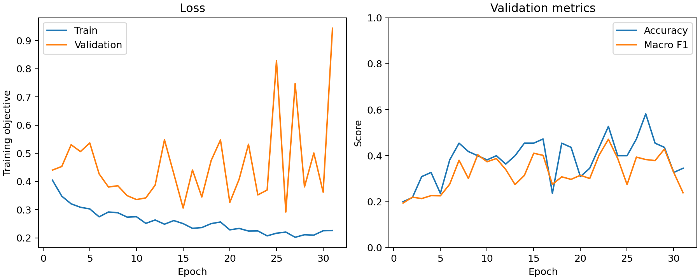
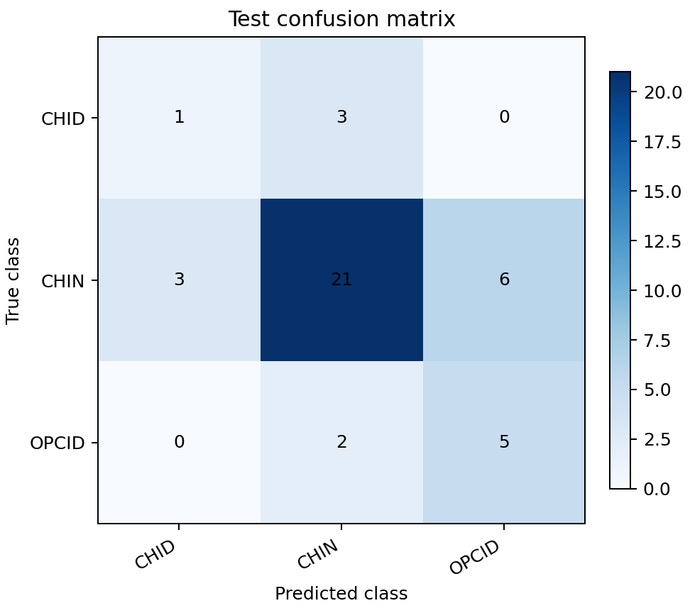

# 任务一：原始数据到三种子Focal训练的隔离复现

## 运行前冻结协议（2026-10-12）

本轮补足此前[既有权重推理](task1-inference-reproduction.md)没有覆盖的重新训练。限定默认160 bp、20,480 bp窗口、原344条标注及248/55/41空间划分；只复现原三个Focal主模型，不重新选择策略、种子、窗口、模型或阈值，不把旧测试集再评估当新泛化实验。

从真实Excel和两份10 bp WT重新解析、划分、提取全部窗口，16×16求和池化、log1p，不复用旧张量训练。全部15字段要求与旧张量精确一致。然后从随机初始化训练三个种子2026/2027/2028；双通道标准化只从训练集估计。

冻结设置：CPU单线程、batch=32、AdamW学习率0.001/权重衰减0.0001、加权Focal gamma=2、最多40轮、验证Macro F1选择最佳轮并patience=8早停。训练逻辑不改，三个种子不因第一个比较不一致而被替换；全部完成后报告一致或差异。

上述优化参数来自已有方法文档与原训练入口默认值；历史输出没有保存完整CLI/CPU线程数，不能声称完全恢复原运行命令。本轮明确记录单线程、torch版本/执行状态；若不一致保留凭据，不试不同线程/容差/超参去追平旧结果。旧权重没有seed字段，仅对这一已知历史差异补核对指标/目录种子，不改写权重。

## 判据与完整证据

- 训练history全部轮次/列/顺序、全部metrics JSON（含验证和测试损失、身份/预测/混淆矩阵）与旧输出比较。离散值精确，浮点绝对/相对容差事前固定1e-12。
- 所有最佳模型state tensor（含BN缓冲）键/形状/dtype一致、非有限值拒绝，数值精确相等；不要求torch文件封装字节相等。不同权重记录逐张量最大差。
- 旧权重元数据除缺失seed外逐项比较；新seed必须与原指标/目录一致，训练尺度同时比较。
- 不预设成功。任何比较差异使总体状态为`diverged`，保存三次结果；异常为`failed`，保存阶段，不覆盖原文件或失败目录。模型训练不读取旧权重；比较仅在各次训练结束后进行。
- 保存原始数据、参考张量/三权重/history/指标、runner及两个辅助脚本、全部输出SHA-256、实际安装来源、环境和用时。完整大文件留在忽略目录，后续提交去本机路径的精简凭据。

这仍是同机同数据的默认主模型复现，不覆盖三分类全部对照、多标签/解释实验、超分辨率重训、跨平台或独立生物学验证，不认证全课程交付。

## 命令

沿用[底座隔离安装](foundation-reproduction.md)的普通wheel与依赖快照。业务包源自`bc384fa551e57cba96457afbcd6a641a936a02e7`；本轮只增加独立核验脚本，没有修改业务训练逻辑。输出目录必须新建或为空：

```bash
env -u PYTHONPATH MPLCONFIGDIR=/tmp/microc-training-repro-mpl \
  outputs/reproduction/clean-venv-20261012/bin/python -I scripts/reproduce_task1_training.py \
  --workbook data/raw/标注数据.xlsx \
  --cool data/raw/GSE272159_37C_rep1.mapq_30.10.cool \
  --cool data/raw/GSE272159_37C_rep2.mapq_30.10.cool \
  --reference-dataset data/processed/task1_windows_full.npz \
  --reference-root outputs/task1_imbalance_comparison/focal \
  --output-dir outputs/reproduction/task1-training-20261012 \
  --source-revision bc384fa551e57cba96457afbcd6a641a936a02e7
```

此协议提交时尚未执行真实重训；以下实际运行结果必须在真实完成后另行记录。

## 实际运行：2026-10-12

冻结提交`075a7a8`之后真实执行一次，无比较失败或调参重试。实际用时150.92秒，包含原始数据哈希、全部窗口重新提取、三次训练与比较。原344×2×128×128张量的15字段全部精确相同，窗口与划分不变。运行环境为Python 3.9.6、macOS arm64、torch 2.8.0；intra-op线程1、interop线程10，未启用全局确定性算法强制开关。

| 种子 | 最佳轮 | 实际轮数 | Accuracy | Macro F1 | history/metrics最大浮点差 | 最佳权重23张量 |
| --- | ---: | ---: | ---: | ---: | ---: | --- |
| 2026 | 23 | 31 | 0.658537 | 0.518519 | 0 | 全部精确相同 |
| 2027 | 16 | 24 | 0.609756 | 0.495319 | 0 | 全部精确相同 |
| 2028 | 30 | 38 | 0.634146 | 0.485810 | 0 | 全部精确相同 |

合计93轮×5列训练日志、三份完整metrics和69个模型参数/BN缓冲张量均与原实验相同，权重最大差0；每份41结构的身份/顺序/真实类别/预测、混淆矩阵、逐类与宏平均指标、验证/测试Focal损失和训练标准化统计都已比较。123条是同41结构的三个模型重复预测，不是新增123个独立样本。训练得到的三种子Macro F1均值仍为0.4999±0.0168，没有性能提升。

旧权重缺seed，新权重包含seed，文件SHA-256因元数据/封装不同而变化；不要求文件字节一致。除这一明确差异外，元数据逐项相同；种子同时核对原指标和目录。历史完整CLI/线程数缺失的记录限制并未因本次碰巧一致而消失，同机复现也不是跨平台确定性保证。

固定首个种子2026的真实重训曲线和混淆矩阵已目视检查，保存如下；没有挑选最高Accuracy的种子作独立新实验。验证Accuracy在第27轮较高，但选择规则是验证Macro F1，故保存第23轮。曲线中后期验证损失仍波动；CHID仍仅1/4正确，精确复现不能解决少数类或泛化问题。





完整receipt、三份新权重及数据保存在`outputs/reproduction/task1-training-20261012/`，未覆盖或提交原始大文件。去本机路径的[精简凭据](task1-training-reproduction-summary.json)保存输入/参考/脚本/输出哈希与所有比较摘要。独立安装包上全仓179项测试通过，0失败/错误/跳过；Ruff无缓存、依赖及旧证据自检通过。旧证据自检不等于任务五重新训练。

已补“原始文件→窗口→主模型训练→逐条结果”的计算链，尚未重训全部类别策略/窗口/分辨率对照、多标签、解释性审查和超分辨率模型；任务二科学缺口、正式报告/PPT/视频/ZIP验收仍未解决。
