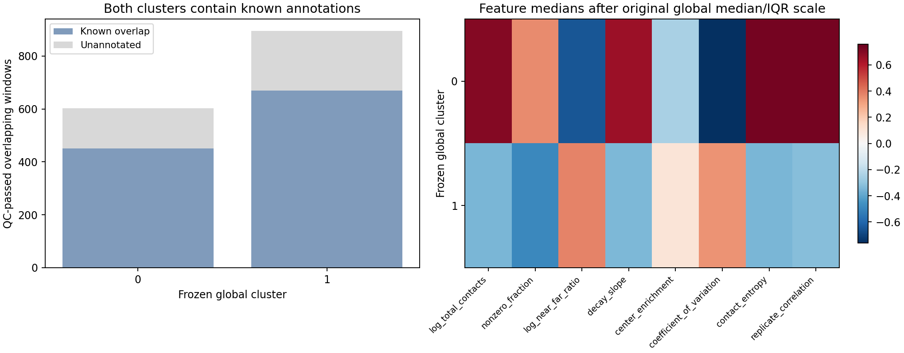
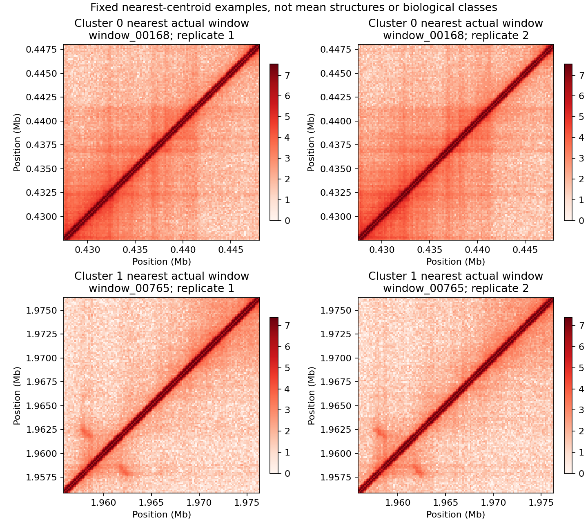

# 任务二：冻结簇成员、中心与候选支持关系核验

核验日期：2026-10-12。协议标识：`task2-main-v1-cluster-evidence-v1`。沿用已保存的窗口、PCA坐标、簇标签与中心，不重训、不重选k、不修改5候选坐标。补足可追溯输出不等于独立的新结构认证。

## 方法与最小运行

先按README生成主流程结果及两份160 bp COOL，再运行：

```bash
PYTHONPATH=src python scripts/export_cluster_evidence.py \
  --windows outputs/task2_clustering/window_clusters.csv \
  --candidates outputs/task2_clustering/candidate_regions.csv \
  --cluster-summary outputs/task2_clustering/summary.json \
  --replicate data/processed/GSE272159_37C_rep1.160bp.cool \
  --replicate data/processed/GSE272159_37C_rep2.160bp.cool \
  --output-dir outputs/task2_cluster_evidence
```

接口检查窗口ID唯一、质控和已知覆盖合法、原8特征中位数/IQR缩放一致、标签与最近保存中心一致、候选支持ID/并集坐标/代表窗口一致，并核对原摘要的簇人数与已知比例。重新由成员计算的PCA中心与保存中心最大绝对差`1.73e-17`。

输出含1,498行成员表（坐标、PC1–3、中心距离、已知重叠、候选角色）、16行特征摘要、2行中心、6行支持簇组成、两张图、真实双重复计数NPZ及五份输入的SHA-256摘要。角色区分未选中、命中但未合并、最终区域支持窗口。输出目录不提交大规模运行文件；附上小型[中心表](task2-cluster-centers.csv)和[支持关系表](task2-candidate-support-clusters.csv)，完整成员表可复算。

## 真实成员与中心

| 全局簇 | 成员 | 已知重叠 | 无已知重叠 | 已知比例 | 初选命中 | 最终支持 |
| --- | ---: | ---: | ---: | ---: | ---: | ---: |
| 0 | 603 | 450 | 153 | 74.63% | 19 | 11 |
| 1 | 895 | 669 | 226 | 74.75% | 6 | 3 |

25个初选窗口中，14个支持5个最终区域，另11个未形成满足最小支持规则的区域。原来“25个窗口合并成5区域”的简写容易让人误解为全部25个参与最终区域，现明确两个阶段。



右图使用原全局中位数/IQR尺度，仅描述8项特征分布；特征包括计数、稀疏度及距离比，不是纯形态或生物学类别。左图显示两簇都混有大量已知标注窗口。

PCA中心不是接触矩阵，不能直接绘成“平均新结构”。固定选择离中心最近的实际成员，不挑最好看的窗口：簇0为`window_00168`，427,520–448,000 bp，重叠CHIN/OPCID；簇1为`window_00765`，1,955,840–1,976,320 bp，无已知重叠。后者无标注不代表整个簇为新结构。



热图由真实COOL原始计数经`log1p`显示；同簇双重复共享99分位色阶，不同簇各自确定色阶，不据跨簇颜色比较绝对强度。

## 候选004的混合归属

候选001/002/003/005的支持窗口均属于全局簇0。候选004代表窗口`window_01354`属簇1，但`window_01352/01353/01354`属簇1、`window_01355`属簇0。原表的簇号只标识代表窗口，不能当作整个区域的单一类别。保留坐标及稳定身份，不为叙述整齐而重分配标签。

## 可讲的结论与尚缺

可以说：“我们核对并保存了窗口的簇归属、中心与候选支持关系；5个候选是区域，不是5种新结构，两个全局簇也不是纯新结构簇。”

仍缺独立数据中的簇归属和更强形态可分性证据。中心来自全基因组WT拟合；相邻窗口重叠，不是独立结构或生物学重复；原8特征的空间留出AUC 0.5582仍不足以支持稳定可分性。本轮没有消除这些限制，也不把最近中心图当作机制解释。
