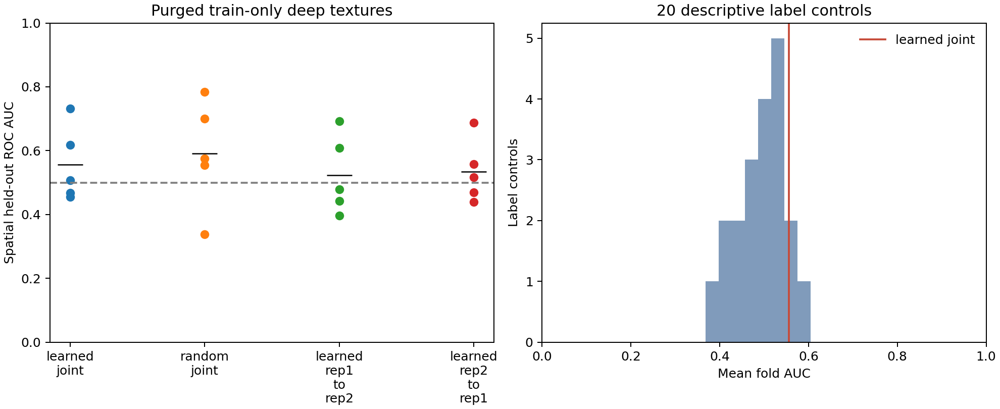

# 任务二：空间隔离自监督纹理的完整对照结果

2026-10-14。协议`e7353fc`提交后执行一次真实五折实验，用时16.804秒。固定187窗口（141已知重叠、46无标注背景），训练窗口154/145/146/147/148，测试窗口32/40/39/38/38；每折20轮，保留5套学习/初始化权重、100轮训练记录及全部留出预测。未调整架构、温度、轮数或阈值。

## 分类与反证

| 表征及方向 | 五折AUC均值±折间SD | 留出召回 | 特异度 | 平衡准确率 |
| --- | ---: | ---: | ---: | ---: |
| 学习网络，双重复均值 | 0.555771±0.117306 | 0.687943 | 0.304348 | 0.496146 |
| 同初始化随机网络，双重复均值 | 0.590267±0.169248 | 0.758865 | 0.347826 | 0.553346 |
| 学习网络，rep1→rep2 | 0.523522±0.123154 | 0.709220 | 0.217391 | 0.463306 |
| 学习网络，rep2→rep1 | 0.533970±0.097426 | 0.716312 | 0.347826 | 0.532069 |

学习联合表征五折AUC为0.507246/0.731602/0.454545/0.467949/0.617512，不能只展示较好的第二折。20次折内标签打乱的平均折AUC 2.5%–97.5%经验范围为0.386763–0.589708，学习结果仍在其中。该稀疏对照不提供生物学p值；不同折模型的汇总留出AUC与折均AUC分别记录，不互换。

## 编码器确实训练，但重复配对不等于结构可分

五折NT-Xent损失首轮→末轮分别为3.3510→0.8446、2.7532→0.7936、3.1543→0.8616、3.0929→0.8388、2.9992→0.7684。留出特征平均维度标准差0.2077–0.2653，不是常数塌缩；学习表征同坐标跨重复检索每折100%，随机网络也达94.87%–100%。

这支持同坐标两重复共享可匹配纹理，但随机网络已能完成匹配，且学习网络未优于随机网络的结构—背景分类。对比目标没有自动形成与现有结构标签一致的可分表征。不得把100%位置检索写成已知结构识别召回或新结构复现率。

## 数值警告核验

首次运行的余弦诊断矩阵乘法出现divide/overflow/invalid警告，但原摘要成功写入且所有诊断有限。训练、分类和预测不使用该诊断输出。随后仅从已保存特征以显式逐项求和重算全部5折/15批诊断，在严格错误模式下无警告，最大差2.22×10⁻¹⁶；原摘要SHA-256保持`b07efb6d0546a2fa44760e92006b4cfbe6ce5773f437ae06aa9b2fa92949685b`。

将诊断实现改为不调用BLAS的einsum并增加数学/异常输入回归测试；未重训、替换原摘要或修饰性能。此核验支持诊断数值稳定，不据此断言全部系统警告的底层原因。

## 范围与产物

完整定义见[冻结协议](task2-deep-texture-protocol.md)，全部拟合系数、逐折诊断/损失及输入哈希见[真实摘要](task2-deep-texture-summary.json)，187行概率见[留出表](task2-deep-texture-predictions.csv)。完整权重、初始化和128维双重复特征位于忽略目录`outputs/task2_deep_texture_20261014/`。

网络仅使用每折保护带外的训练矩阵；分类缩放及权重仅拟合训练标签。表征是对[SimCLR](https://arxiv.org/abs/2002.05709)投影与对比思想的自然重复配对改编，不是原论文实验复现。现有空间网格曾被检查，无标注不是真阴性，任意重叠标签仍有尺度歧义。本轮没有证明稳定可分性、形成新结构簇或确认五候选；原主结果及全部失败继续保留。
