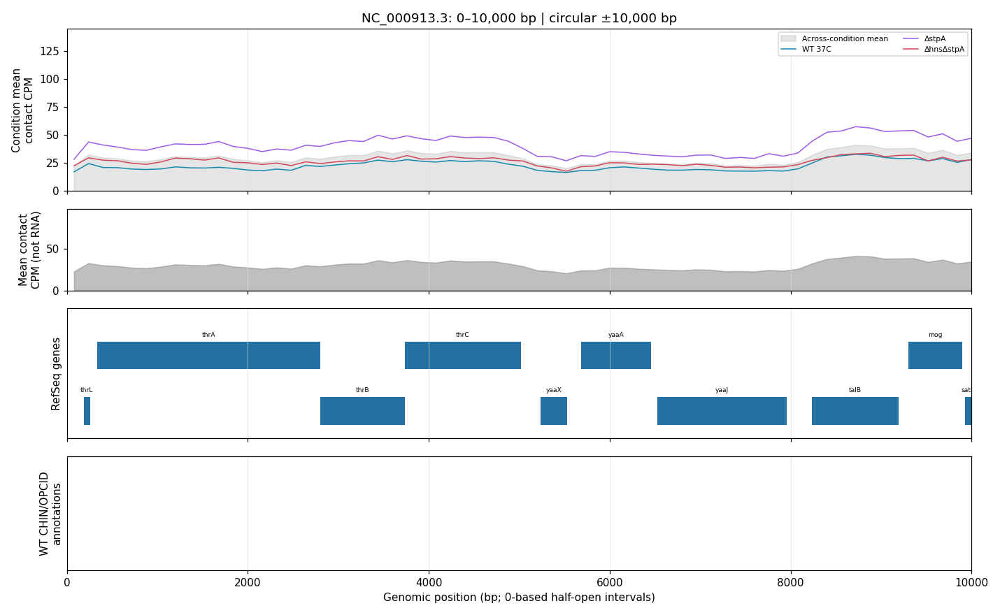
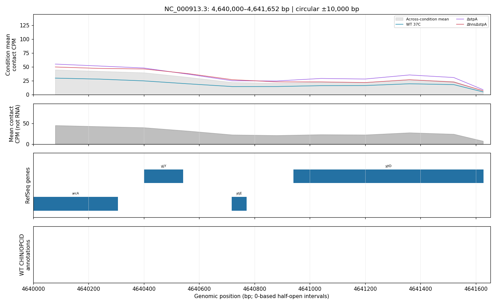

# 任务三六原始矩阵与全图隔离复现

协议冻结日期：2026-10-12。本轮从六份10 bp原始矩阵、原始Excel和RefSeq GFF重建三条件轨道及465张四面板图。不改CPM定义、重复权重、距离范围、色标、基因/结构规则或图像参数。复现不等于显著差异检验或独立生物学实验。

## 预先冻结的验收规则

- 使用已经验证的独立虚拟环境、普通wheel和`python -I`，不注入源码路径；业务包从`bc384fa`至本轮未改变，脚本和比较辅助程序另外版本化并保存哈希。
- 新输出目录必须为空；六原始输入不同。六份160 bp矩阵全部重新求和池化，拒绝缓存，逐bin与全部上三角pixel对比旧池化矩阵，并检查原始计数总量守恒。
- 从原始Excel重建344结构，从GFF转换基因坐标、环状跨原点区间；重新计算29,011个bin的三条件均值/双重复标准差/等权跨条件均值，完整轨道表全列全行比较。
- provenance与manifest只把六个源文件路径规范化为有序文件名，保留条件、重复身份、计数与方法。JSON逐项比较；浮点容差固定为相对/绝对1e-12，身份/坐标/顺序/图层计数须完全一致。
- 重绘全部465图，不以文件存在代替重绘。清单必须完整、无间隙、末段到4,641,652；全部PNG完整解码、尺寸一致、RGBA像素与旧图精确相同。PNG压缩字节/附加元数据不作为要求；如不同则报告失败，不放宽规则事后包装成功。
- 固定人工复核0–10 kb（无已知结构轨道）、50–60 kb（OPCID_1/CHIN_1）、末段4,640,000–4,641,652 bp。像素相同不保证历史图层语义正确，人工只复核明确案例，不声称逐张人工验收。
- 失败保留阶段、错误和已有文件；不覆盖旧结果。输入/旧参考/输出/脚本哈希、环境及用时保存于receipt。该规则仅对当前同机同软件复现，不保证跨平台字体/绘图像素相同。

## 执行命令

在仓库根目录运行；新机器先按[隔离环境说明](foundation-reproduction.md)安装普通wheel。重跑使用新的空输出目录：

```bash
env -u PYTHONPATH MPLCONFIGDIR=/tmp/microc-task3-repro-mpl \
  outputs/reproduction/clean-venv-20261012/bin/python -I scripts/reproduce_task3.py \
  --wt-rep1 data/raw/GSE272159_37C_rep1.mapq_30.10.cool \
  --wt-rep2 data/raw/GSE272159_37C_rep2.mapq_30.10.cool \
  --dstpa-rep1 data/raw/GSM8950761_DstpA_rep1.MG1655.mapq_30.10.cool.gz \
  --dstpa-rep2 data/raw/GSM8950762_DstpA_rep2.MG1655.mapq_30.10.cool.gz \
  --double-rep1 data/raw/GSM8950763_DhnsDstpA_rep1.MG1655.mapq_30.10.cool.gz \
  --double-rep2 data/raw/GSM8950764_DhnsDstpA_rep2.MG1655.mapq_30.10.cool.gz \
  --workbook data/raw/标注数据.xlsx --gff data/raw/NC_000913.3.gff.gz \
  --reference-coarsened-dir data/processed/task3-160bp \
  --reference-dir outputs/task3/condition-comparison \
  --output-dir outputs/reproduction/task3-20261012 \
  --source-revision bc384fa551e57cba96457afbcd6a641a936a02e7
```

运行器通过显式文件路径加载`reproduce_task2.py`的环境、数值/JSON/COOL比较辅助函数；不将脚本目录加入业务包搜索路径。这两个脚本必须一起保留。

## 2026-10-12实际结果

协议先提交为`09bd308`，随后真实执行，用时269.14秒，全阶段通过，无比较失败、无参数修改。六份新池化矩阵各29,011个bin及全部上三角pixel与旧池化文件精确一致，六原始计数总和均守恒。重新生成29,011×11轨道表、来源与465区间清单，浮点最大差0；全部465张1430×880 PNG解码后RGBA像素完全一致、最大通道差0。

完整哈希、环境、各样本pixel数量、输出和receipt位于Git忽略目录`outputs/reproduction/task3-20261012/`，去本机路径的[精简凭据](task3-reproduction-summary.json)随文档保存。不能因为PNG相同就省略重算：本轮的全部六份池化文件、轨道和图均新建，不复用旧缓存；比较旧文件只用于验收。HDF5/PNG容器字节不作为一般复现要求。

新增8项测试后隔离环境全仓169项通过，0失败/错误/跳过；Ruff无缓存与依赖检查通过。运行器与辅助脚本单独版本化，旧wheel业务代码自`bc384fa`未变化；不将新增运行器说成旧wheel内已有模块。

## 固定案例目视核验



首段有基因与三条件信号，无CHIN/OPCID条带与清单一致。空白注释轨道只表示当前清单无该类标注，不代表没有染色质结构。


图层、名称及共享坐标已复核。此文档沿用已提交案例图，因为其与本轮重绘相应文件逐像素相同；条带在窗口边界截断不是结构真实终点，曲线共定位也不是转录或条件因果证据。



末段基因轨道包含4个gene segments，结构轨道为空。终点与实际染色体长度一致，未虚构完整10 kb尾段。最后bin为4,641,600–4,641,652，仅52 bp而非160 bp；轨道是每bin接触CPM，未按bin宽度做每bp密度归一化，尾端低值可能受bin宽度影响，不能直接解释为染色质结构消失。

上述是预定三例目视核验，不是全部465张图的逐张人工语义验收。分类/超分辨率重新训练及最终PPT、视频、代码ZIP验收仍未完成；三条件差异仍为描述性观察，未做显著性检验。
