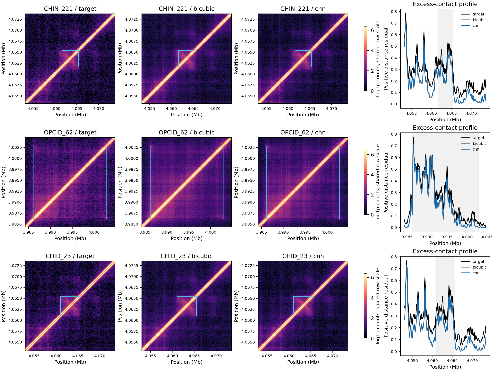

# 任务五：已知区间形态与信号位置核验

2026-10-13。协议`6461b2b`先冻结，之后一次核验全部41结构、双通道、三种子，不重训/调参。定义见[协议](task5-shape-position-protocol.md)，输入哈希与全统计见[摘要](task5-shape-position-summary.json)。各结构内平均通道/种子指标，不把492行计算当独立生物学样本。

| 指标 | 双三次均值 | CNN均值 | 改善/相同/变差 |
| --- | ---: | ---: | --- |
| 已知区间800–6,400 bp残差形态r | 0.738595 | 0.741465 | 32/0/9 |
| 超额接触轮廓r | 0.986702 | 0.987071 | 33/0/8 |
| 最大轮廓峰位移（bp，越低越好） | 582.439 | 760.000 | 4/35/2 |
| 前10%轮廓位置Jaccard | 0.810119 | 0.815164 | 14/15/12 |

| 类别 | n | 双三次/CNN形态r | 双三次/CNN峰位移（bp） |
| --- | ---: | --- | --- |
| CHIN | 30 | 0.744961/0.746411 | 690.667/935.556 |
| OPCID | 7 | 0.696061/0.704062 | 22.857/17.143 |
| CHID | 4 | 0.765280/0.769827 | 750.000/743.333 |

0项指标缺失。两个更差案例CHIN_235（1,760→6,240 bp）、CHIN_238（0→2,906.667 bp）均为结构内平均。seed2026真实目标最大峰落在标注内的通道比例：CHIN 1/60、OPCID 10/14、CHID 4/8。因此全窗最大峰不是通用CHIN定位器，仅描述信号位置保真，不当结构边界/身份恢复率。

固定seed2026/rep1、每类旧测试首项CHIN_221/OPCID_62/CHID_23；行内共享目标99.5%分位色阶，跨行不比较绝对颜色。青框是区间双轴交集，右图灰范围是标注，不是形态真值。CHIN_221和CHID_23空间重叠，非独立复现实例。目视可见宽尺度模式相近，但细粒度形态/峰幅值存在差异，不能宣称全部位置稳定恢复。

产物为492通道指标、82结构均值、6类别摘要、4配对对照、三个轮廓NPZ；完整输出在忽略目录`outputs/task5_shape_position_20261013/`。公开[逐结构](task5-shape-position-structures.csv)、[类别](task5-shape-position-classes.csv)、[配对](task5-shape-position-paired.csv)。

本项补齐三类直接图表及反证，原模型/PSNR/SSIM/严格history差异不变；像素、形态与定位分别评价。固定测试区和代理指标不替代独立结构检测或外部实验。
